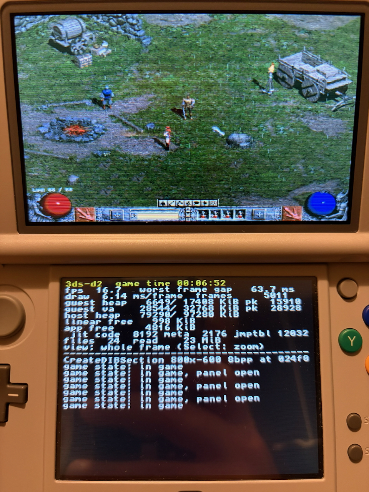

# 3ds-d2

Diablo II: Lord of Destruction 1.14d on the New 3DS.

3ds-d2 runs the unmodified Windows `Game.exe` of Diablo II 1.14d on a New 3DS. The x86 code runs through an ARMv6 port of the Box86 dynamic recompiler (from the WinVita engine). The Windows APIs the game calls come from 3ds-d2's own runtime. The hottest drawing routines run as native ARM code. The game itself is not included: you need your own copy of Diablo II and Lord of Destruction, patched to 1.14d.

**Status:** early, version 0.2.0. On a real New 3DS the game runs from the main menu through character creation into the Rogue Encampment and the Blood Moor, with sound, and plays the cinematics ([docs/cinematics.md](docs/cinematics.md)). The frame rate is still below the game's own 25 fps in busy areas.

<p align="center">
  
  <br>
  <em>Milestone screenshot: The first run on a real New 3DS, in the Rogue Encampment: the game on the top screen, frame rate and memory on the bottom screen.</em>
</p>

## Requirements

- A **New 3DS, New 3DS XL or New 2DS XL**. The original 3DS and 2DS do not have enough memory or CPU.
- **Luma3DS** custom firmware.
- **FBI** (or another CIA installer).
- About **2 GB free** on the SD card for the game files.
- Your own **Diablo II + Lord of Destruction**, patched to **1.14d**. The current Blizzard installers for Diablo II and Lord of Destruction install 1.14d.
- For sound: a **DSP firmware dump** at `sdmc:/3ds/dspfirm.cdc` (see [step 2](#2-dump-the-dsp-firmware-for-sound)).

## Setup

### 1. Copy the game files to the SD card

Create the folder `/3ds/3ds-d2/game/` on the SD card. Copy these 12 files from your Diablo II installation folder into it, with these names:

| File | Size | Contents |
| --- | ---: | --- |
| `Game.exe` | 3.6 MB | the game, version 1.14d |
| `d2char.mpq` | 266 MB | character graphics |
| `d2data.mpq` | 269 MB | game data |
| `d2exp.mpq` | 250 MB | Lord of Destruction data |
| `d2music.mpq` | 348 MB | music |
| `d2sfx.mpq` | 49 MB | sound effects |
| `d2speech.mpq` | 163 MB | speech |
| `d2video.mpq` | 442 MB | cinematics |
| `d2xmusic.mpq` | 55 MB | Lord of Destruction music |
| `d2xtalk.mpq` | 60 MB | Lord of Destruction speech |
| `d2xvideo.mpq` | 111 MB | Lord of Destruction cinematics |
| `patch_d2.mpq` | 5.7 MB | the 1.14d patch data |

That is about 1.9 GB in total. The game checks for every one of these files at startup, so copy all of them, cinematics included. The game needs no other files from the installation folder: since 1.14, Diablo II has no DLLs of its own.

The finished folder looks like this:

```
SD card
└── 3ds
    ├── dspfirm.cdc          (for sound)
    └── 3ds-d2
        └── game
            ├── Game.exe
            ├── d2char.mpq
            ├── d2data.mpq
            ├── ...
            └── patch_d2.mpq
```

The app creates `save/` (characters and settings) and `logs/` (`game.log`, `stderr.txt`) next to `game/` the first time it runs.

To check that your `Game.exe` is the 1.14d build this project is tested with, its SHA-256 should be `631066c1649c4ea9ffe48bf97e24c00bca1f7a6759c21150f1a79982589adaaf`. The app does not check the hash itself. The patches it applies check the bytes they replace and skip anything that does not match, so other builds of `Game.exe` are not supported.

### 2. Dump the DSP firmware (for sound)

Homebrew apps can play sound only through the 3DS's DSP. Its firmware comes from your own console and can't be shipped with the app, so you dump it once:

1. Get **DSP1** (`DSP1.3dsx`, by zoogie) and copy it to `/3ds/` on the SD card.
2. Start the **Homebrew Launcher** (on Luma3DS, through the Rosalina menu) and run DSP1.
3. It writes `/3ds/dspfirm.cdc` and tells you when it is done.

If you set up your console with the 3ds.hacks.guide, you may have done this already: check whether `/3ds/dspfirm.cdc` exists. The dump is needed only once, for every homebrew app. Without it 3ds-d2 still runs, but silently, and `logs/game.log` says `ndspInit failed`.

### 3. Install the app

Build the CIA as described under [Building the CIA](#building-the-cia), then install `3ds-d2-<build-id>.cia` with FBI. Either copy it to the SD card and pick it in FBI under *SD*, or use FBI's *Remote Install*. The HOME menu then shows a **3ds-d2** icon (title ID `000400000D2D3D00`).

The CIA holds only the app, about 2 MB. A new version is a quick reinstall over the old one, and the game files on the SD card stay where they are.

### 4. Play

Start 3ds-d2 from the HOME menu. The game appears on the top screen. The bottom screen shows frame rate and memory use, and works as a touchpad.

| Input | Action |
| --- | --- |
| Circle pad | Walk (in the game world); move the cursor (in menus and panels) |
| C-stick | Move the cursor |
| Touch screen | Touchpad: drag moves the cursor, a short tap clicks |
| A / B | Left / right mouse button |
| X | Inventory |
| Y | Show items on the ground (held) |
| L | Stand still (held) |
| D-pad | Belt potions 1–4 |
| ZL / ZR | Weapon swap / automap |
| Start | Game menu, close panels |
| Select | Top screen: whole frame ↔ 1:1 zoom for reading text |
| A, B, Start or a tap | During a cinematic: skip it |
| R + A / B / X / Y | Character screen / skill tree / automap / quests |
| R + D-pad | Skill hotkeys F1–F4 |
| R + Start | Enter (confirm) |
| R + Select | On-screen keyboard |
| L + R + Select | Screenshot into the Camera album |

When the game asks for text, such as a character name, a keyboard opens on the bottom screen. Tap the keys. B deletes, Y is shift, Start confirms, Select closes it. R + Select opens the keyboard at any time. [docs/controls.md](docs/controls.md) has the full mapping.

If the app shows "Game.exe not found", check the folder name and that `Game.exe` is inside `/3ds/3ds-d2/game/`.

## Building the CIA

Everything builds inside Docker containers with a pinned toolchain (devkitARM, libctru, makerom). The host needs only **Docker** and **git**: Docker Desktop on macOS (Apple Silicon or Intel) or Windows, or Docker Engine on Linux. You don't need the game files to build the app.

1. **Get the source with its submodule.** The CPU backend (WinVita, with Box86) is a git submodule, so clone recursively:

   ```sh
   git clone --recursive https://github.com/exsilium/3ds-d2.git
   cd 3ds-d2
   ```

   For a copy cloned without `--recursive`, run `git submodule update --init` first.

2. **Build the toolchain images, once.** This downloads and builds the pinned tools, and takes a few minutes the first time:

   ```sh
   scripts/docker.sh image
   ```

3. **Build the CIA.**

   ```sh
   scripts/docker.sh package-cia
   ```

   On the first run this also builds the CIA tools image. It then compiles the CPU backend with this project's patches and the 3DS app, and packs the CIA. The last lines show the result:

   ```
   cia: 3ds-d2-<build-id>.cia
   version: 0.2.0
   sha256: ...
   ```

The output goes to `dist/cia/`:
- `3ds-d2-<build-id>.cia`: the app to install (step 3 above).
- `3ds-d2-<build-id>.elf`: the same code with debug symbols, for reading crash dumps (`tools/luma_dump.py`).
- `3ds-d2-<build-id>.cia.txt`: version, size and SHA-256. To check that a copy on the SD card is intact, compare its SHA-256 with this file.

The build ID is a hash of everything that goes into the CIA, so the same sources always produce the same name, and any change gives a new one. Builds run without network access, and the game files never enter an image.

Two variants carry the game files inside the CIA itself instead of reading them from the SD card. Such a CIA is for your own console only:
- `scripts/docker.sh package-cia --full <game-dir>`: all 12 files (~2 GB).
- `scripts/docker.sh package-cia --slim <game-dir>`: without music, speech and cinematics (~850 MB, no sound).

More documentation:
- [docs/build-and-run.md](docs/build-and-run.md): builds, tests and the Azahar emulator lanes.
- [docs/hardware-test.md](docs/hardware-test.md): installing, what the bottom screen shows, reading crash dumps.
- [docs/architecture.md](docs/architecture.md): how the pieces fit together.

## References

Projects this one builds on, learned from or uses.

**Built on**
- [WinVita](https://github.com/Franckrst/WinVita) (MIT): the Win32 engine for running Windows executables on a console: PE loader, import bridge, guest threads, and the Box86-based CPU backend and DirectSound emulation. It is the submodule `third_party/winx86`, and this project's ARMv6 port is a patch series on top of it.
- [Box86](https://github.com/ptitSeb/box86) (MIT): the x86-to-ARM dynamic recompiler at the core of WinVita's CPU backend, ported here to the 3DS's ARMv6K.

**Inspiration and reference**
- [D2Vita](https://github.com/Franckrst/D2Vita) (GPL-3.0): Diablo II 1.14d on the PlayStation Vita, built on WinVita. It proved the approach on this exact executable. It was used only as a behavioural reference, for game facts such as memory addresses and the sprite-cache sizing, and for its control ideas. None of its code is in this project.
- [DOSBox-3DS](https://github.com/MrHuu/dosbox-3ds) (GPL-2.0): read to confirm how a 3DS homebrew app makes JIT memory executable (`svcControlProcessMemory`). None of its code is used.
- [DOSBox-X](https://dosbox-x.com/) and [M-HT/SR](https://github.com/M-HT/SR) (static recompilation of DOS and Windows games): evaluated as alternative CPU approaches while planning.

**3DS platform and tools**
- [devkitPro](https://github.com/devkitPro): devkitARM, [libctru](https://github.com/devkitPro/libctru) and [citro3d](https://github.com/devkitPro/citro3d), from the [devkitPro Docker images](https://github.com/devkitPro/docker).
- [Project_CTR](https://github.com/3DSGuy/Project_CTR): makerom and ctrtool, to build and check CIAs.
- [3ds-bannertool](https://github.com/carstene1ns/3ds-bannertool): the HOME menu icon and banner.
- [Azahar](https://github.com/azahar-emu/azahar): the 3DS emulator used for testing.
- [StormLib](https://github.com/ladislav-zezula/StormLib): MPQ archive library, used by the D2Vita reference build that served for measurements.

**On the console**
- [Luma3DS](https://github.com/LumaTeam/Luma3DS): the custom firmware the app needs (its system calls make the JIT work on hardware).
- [FBI](https://github.com/Steveice10/FBI): CIA installer.
- [DSP1](https://github.com/zoogie/DSP1): dumps the DSP firmware for sound.

## Legal

3ds-d2 is licensed under the BSD 2-Clause License ([LICENSE](LICENSE)). Third-party components and their licences are listed in [THIRD_PARTY_NOTICES.md](THIRD_PARTY_NOTICES.md).

Diablo II and Lord of Destruction are trademarks of Blizzard Entertainment. This project is not affiliated with or endorsed by Blizzard, and it contains no game files or code. You need your own legally obtained copy of the game.
