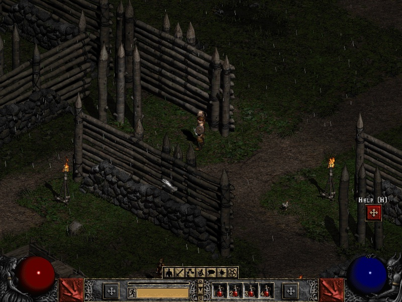
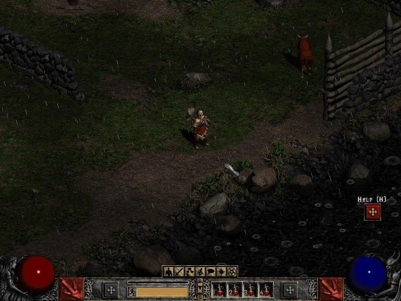
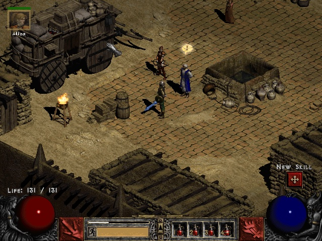

# Ahead-of-time compilation: design note

Status: reviewed (issue #112, part of #111), and its spike built (#113, [below](#the-spike-113)). Figures marked *estimate* are worked out from the measurements named next to them; the spike's measurements replace some of them, and say so.

## The idea in one paragraph

Today Box86 translates Game.exe's x86 code to ARM while the game runs. The translation layer costs about 31 MiB of the app's 124 MiB, and the code it makes is 7.22 times the size of the x86 it came from. An ahead-of-time (AOT) recompiler would run once, inside `scripts/docker.sh package-cia`, on the user's own Game.exe. It would write each game function out as C, compile it with devkitARM's gcc, and link it into the user's own CIA. Box86 stays in the app for whatever the recompiler missed. **We distribute the recompiler, never its output.**

## What we start from

All counts are for 1.14d's Game.exe, measured on 2026-11-13.

| What | Figure | Source |
| --- | --- | --- |
| `.text` | 2,928,640 bytes at `0x401000`–`0x6cc000` | the PE headers |
| Function starts, ours | 13,170 | `tools/profile_report.py`'s `Binary` (call targets, relocated pointers, the natives' sites) |
| Functions with sizes, d2d's | 13,048, 2,600,618 bytes in all (median 106 bytes, the largest 15,513) | `third_party/d2d/docs/research/re/game-functions.tsv` at `0a70175` |
| In both lists / only ours / only d2d's | 11,365 / 1,805 / 1,683 | `tools/function_starts.py` (#107) |
| Instructions in d2d's functions | 878,540 (2.96 bytes on average) | linear disassembly with Capstone, function by function |
| Direct calls, indirect calls, `ret`s | 72,481 / 4,622 / 22,243 | the same pass |
| Indirect `jmp`s, of them through a `[reg*4 + table]` | 710 / 550 | the same pass |
| x87 instructions | 4,223 | the same pass |
| Functions whose bytes don't decode linearly to their end | 374 | the same pass: data in the code, mostly switch tables |
| Imports | 371 | `profile_report.py`'s import table |
| Natives | 49 sites | [natives.md](natives.md) |

What the translation layer costs today ([memory-budget.md](memory-budget.md), "The heap's last MiB is shared" and the ledger above it):

| Part | Size |
| --- | --- |
| Code pool (`dyn86_ctr_jitpool`, `src/app/ctr_game.cpp`) | 14 MiB |
| Jump tables (256 KiB per 64 KiB of guest code that ever ran) | about 12 MiB in play |
| Block records (`meta=`) | 3–4 MiB, growing through a session |
| Translation scratch and first-level tables (`static_insts`, `box86_jmptbl`, `box86_jmptbl_default`) | about 1.4 MiB |
| **In all** | **about 31 MiB** |

The Box86 port's code is 7.22 times its x86 (town scenario, [architecture.md](architecture.md) §7a: 1.29 MB of x86 became 9.31 MB of ARMv6).

## Function discovery

The recompiler needs to know where functions start, where they end, and which bytes in `.text` are not code. Each source below adds starts; none of them is trusted alone.

- **Direct calls.** Every `call rel32` target in `.text`. `profile_report.py` already does this, and it finds strays: an `E8` byte inside another instruction. A start is kept only if its function decodes cleanly from it.
- **Relocations.** Game.exe has 63,121 base relocations.
  - 4,026 of them place a pointer into `.text` in a data section: vtables, callback tables, thread entries.
  - 1,357 are the immediate of a `push` or `mov` in `.text`: callbacks and thread entries passed as arguments.
  - The other 5,926 relocated words in `.text` that point into `.text` are mostly switch-table entries (below). They are jump targets inside a function, not function starts.
- **d2d's list (#107).** Its 13,048 functions come with sizes, which our finder doesn't have. The recompiler reads `game-functions.tsv` from the submodule at build time when it is there. It never copies it into our tree.
- **What the game was seen to run.** The lane's block counts (`WX86_HOTPROF`) and Box86's jump tables after a session list the entry points that actually ran, indirect targets included.
- **The cross-check.** A start that only one source has is reported (`tools/function_starts.py`, #107), and checked by hand while the coverage grows (#115).
  - Of d2d's 1,683 starts that ours lacks, 245 are reached through a relocated pointer in a `mov [mem], imm32`, which our finder doesn't take yet, and 185 only by a `jmp`. The recompiler's finder should take both.

**Switch tables and data in the code.** MSVC puts a switch's jump table (and sometimes a byte index table before it) in `.text`, right after the function. The 550 `jmp [reg*4 + table]` instructions are those switches.
- The recompiler reads each table's entries through its relocations. It bounds the table by the `cmp`/`ja` that guards the index.
- The table's bytes are marked as data, so disassembly stops there. That is most of the 374 functions that don't decode to their end.
- A switch is translated to a C `switch` over the same targets. An index the guard didn't bound goes to the fallback.

**Thunks.** A function that is only a `jmp` to another is compiled as a call to its target. An import is called through its IAT slot (`call [slot]`, or `jmp [slot]` as a thunk). That call goes to our runtime's shim directly (see Calls).

**Patched code.** The runtime changes Game.exe's code before it runs. It writes the hooks' `jmp`s and the in-line sites' `call`s, an immediate (`set_sprite_cache_floor`), stubs in padding (`install_pool_release`, `set_pool_block_size`), and `install_fatal_exit` and `install_ftol`. The recompiler has to see the same code the game runs.
- So these sites need to become one table that the app's installers and the recompiler both read: address, expected bytes, and what replaces them. Today they are spread over `install_*` functions in `src/game/`.
- A site the recompiler doesn't understand leaves its function to Box86.

## Translation model

One x86 function becomes one C function. The C is plain and boring, so that gcc does the optimising.

**Registers.** The eight x86 registers are C locals (`uint32_t eax, ...`). gcc keeps them in ARM registers across the function, which Box86 can't do across its blocks.

**The register interface between compiled functions** (the review's first point, built in the spike). The game passes arguments in registers of its own choosing (`UnitRelation` takes a and b in `ecx` and `edx`, A*'s helpers take theirs in `eax`, `esi`, `edi`), so MSVC's conventions can't be assumed. Each compiled function gets a signature from a liveness pass across functions:
- **in:** the registers it reads before writing them, given its callees' signatures;
- **out:** the registers its compiled callers read after calling it; for a function Box86 calls, MSVC's rule (eax and the callee-saved registers it doesn't keep);
- **preserved:** the registers equal to their entry values at every `ret`, from tracking pushes and pops through the frame.

They become C arguments and results: `esp` and the ins as arguments, one out as the return value, two as a `uint64_t`, more through a pointer. `esp` after the call is the caller's own arithmetic (`+4 + ret N`), checked at run time at each `ret`. The two passes run to a joint fixed point from nothing up.
- **Precision that mattered.** Liveness works on half registers: MSVC's `mov cx, [..]; movzx ecx, cx` reads no more of `ecx` than its low half, and counting the partial write as a read made `ecx` an output of most of A*'s functions. The prologue's saves of callee-saved registers aren't counted as reads (the slot is written only in the context build; see below), but only the entry block's leading run, each popped back into the same register: a `push esi` just before a call is an argument when `esi` still holds its entry value.
- **What other code is assumed to do.** For code Box86 runs, the pass reads its summary where it can, and otherwise assumes MSVC's ABI: `ebx`, `ebp`, `esi` and `edi` survive any call (link-time code generation moves arguments, not those). An indirect call reads at most `ecx` and `edx` (a function whose address is taken keeps a standard convention). An import reads no register; its `ret N` comes from our shims' declared argument counts (`src/runtime/rt_shims_*.cpp`, 296 of the 371 imports, and the `_Name@N` decorations). The game's fatal-error and exit paths (calls that never return, including the C runtime's `exit`, 0x681e09) read nothing. The lane's check compares the callee-saved registers after every checked call, which tests these assumptions.
- **The safe fallback** passes all eight registers through a context struct at every call and stores every push. Both are built from the same pass, and the spike measures the difference.

**Memory.** The same guest memory model as today: the game's address space is one block, and host = guest + base ([natives.md](natives.md): `H(va)`, `U32(va)`, `put32(va, v)` in `src/game/d2_native.cpp`; `g_base` there). Every load and store goes through those helpers, with `memcpy` so unaligned access is legal on the ARM11. The game's structures keep their x86 layout, because the 3DS is 32-bit and little-endian too. There is no other memory model to keep in step with Box86, natives and shims.

**Flags.** They are lazy, and only computed where they are read.
- Per function, a liveness pass finds which instruction reads which flag. `cmp`/`test` followed by `jcc` or `setcc` becomes a C comparison, and no flags are kept.
- Flags that live across a basic block are kept as the last operation's operands and result, and worked out from those when read, as Box86 does.
- 1,880 `adc`/`sbb` instructions read the carry flag, and only 15 instructions move flags to a register (`pushfd`, `popfd`, `lahf`, `sahf`). Those get the full computation.
- At a call, a `ret` or an exit to the dispatcher, the flags are assumed dead, as MSVC's code expects. Over the whole binary, 12 of d2d's functions read flags that a call or their caller left (the spike's survey, below). Those stay with Box86.
- **Which instructions write flags** comes from a table of our own, not Capstone's alone: Capstone 5 reports none for `test` with a memory operand (opcodes 84 and 85, 547 of the 164,075 flag-setting instructions in d2d's functions). Trusting it made a `jne` after `test word ptr [eax], si` read an older `cmp`'s flags, which the host cases caught.
- In the spike's code every reader is a `jcc` after `cmp`, `sub`, `test`, `and` or `add`, or an `sbb` after `neg`. The reader's condition is a compare on the defining instruction's operands, which gcc folds.

**x87.** The game takes its x87 and integer paths, because the port reports no SSE (`RunOptions::cpuid_edx`). So the 4,223 x87 instructions matter, though they are 0.5% of the code.
- **Where the stack lives** (#136): compiled code works on the CPU's own x87 state, Box86's `x86emu_t` fields from `cw` to `fpu_ll` (`Cpu::x87_state()`, backend patch 0065; `AotFpu` in `src/game/aot_rt.h` mirrors them, the offsets checked on both sides). Each push and pop moves `top` at run time, as Box86 does.
  - The depth needn't be known where the code is compiled. That matters: 75 of the 206 functions with x87 code have no fixed depth, and some of the game's own functions take or leave values on the stack (4b98f0 takes three, 4b97d0 leaves two), not only the C runtime's `_ftol`.
  - A callout, an exit to the dispatcher or Box86 entering compiled code finds the stack as Box86 left it, with nothing to convert. The dynarec writes its cached x87 registers back before an in-line call (`BARRIER_FLOAT` at the native-call stub), at a trap and at a block's end.
  - The cost is a load and a store through a pointer for each operand, where locals could have stayed in registers. x87 is about 1% of the hot bytes.
- **Precision** is Box86's on this port: 64-bit doubles on VFPv2, not 80-bit. The game sets the x87 to 53-bit precision (MSVC's runtime does; #125 found it: Unicorn starts at 64), so for ordinary arithmetic doubles match a real CPU too. They differ where the exponent range does (the x87 keeps a 15-bit exponent in its registers even at 53-bit precision: denormals and overflow).
- **Every value a double** (backend patch 0066, `box86_dynarec_x87double = 1`): before it, the dynarec could keep a value loaded from a float (`fld m32`, `fld1`, `fild m16`) in single precision through a block, by rules that depend on where the block ends. Compiled code can't follow those rules, and a real x87 at 53-bit precision computes in double.
- **Each instruction does what the dynarec does**, not what the interpreter's helpers do (the build has no interpreter):
  - The arithmetic runs in the FPSCR's mode on the same thread. `cw`'s rounding control counts only for `fist`/`fistp` and `frndint`, and its precision control for nothing.
  - `fist` gives 0x80000000 (m32), 0x8000 (m16) or 0x8000000000000000 (m64) for NaN or out of range.
  - `fild m64` builds its value from the high word times 2^32 plus the low word. A later `fistp m64` stores the original int64 if st0 is still that value. `fld m80` keeps its 10 bytes the same way for `fstp m80`, through Box86's own `LD2D`/`D2LD`.
  - `fsin`, `fcos`, `fyl2x` (log2), `f2xm1` (expm1) and `fscale` (ldexp) call libm, the same libm Box86 calls. `f2xm1` followed by `fld1` and `faddp st(1)` is one `exp2`, as Box86 makes it. `fprem1` rounds its quotient toward +infinity, as the dynarec's does.
  - `fnstsw` puts `top` in bits 11-13 of the value it stores and leaves `sw` as it is.
  - The x87 decoding goes by opcode and ModR/M, not by Capstone's mnemonics. What an x87 instruction stores comes from a table of our own: Capstone 5 calls `fst`, `fstp` and `fistp` m32/m64 and `fnstcw` reads, `frstor` a write, and `fnsave` 4 bytes.
  - Left to Box86 for now: `fld m80` followed by `fstp m80` and `fild m64` followed by `fistp m64` (Box86 copies the bytes without the value), `ficom`, the m16 integer arithmetic (which Box86 itself can't run), `fnsave`/`frstor`, `fxam`, `fptan`, `fpatan` and the `fcomi` forms. None of them was a function's first refusal on d2d's list.
- **The check** compares the x87 state after each call too: `cw`, the condition codes, the depth and each value on the stack, from each side's own `top` (the dynarec writes `top` 0 when its cache held all eight).

**Instruction kinds the note didn't cover** (the review's fourth point; counted over d2d's 13,048 functions):

| Instructions | Count | What AOT code does |
| --- | --- | --- |
| `fs:` accesses | 268, in 83 functions | the running thread's TEB through `aot_fs_base()` (`rt::current_teb()`); SEH frames (`fs:[0]`) are memory like any other |
| `rep movs`, `rep stos` | 608 | the copy or fill, element by element where it overlaps forward, with the direction flag known at each instruction (clear at entry and after calls, MSVC's rule; `std`/`cld` change it; a function where it isn't known stays with Box86) |
| `fldcw` | 40 | stores `cw` (#136); it changes only how `fist` and `frndint` round, as in Box86 |
| `cpuid` | 6 | to answer as `RunOptions::cpuid_edx` (not in the spike) |
| `rdtsc` | 1 | from the same source as Box86's (not in the spike) |

The spike's two trees have none of these. Since #136 x87 is compiled; `cpuid` and `rdtsc` still leave their function to Box86.

**The C runtime's quirks.**
- `_ftol2` (`0x682fd0`): the port already jumps over its SSE2 check, so the `cvttsd2si` path always runs (`install_ftol`). The recompiler turns a call to it into a truncating conversion in line.
- The C runtime's `memcpy` and `memset`: calls to the memory intrinsics' native copies (`D2_MEMINTRIN`, backend patch 0016; `dyn86_mi_arm` in `d2_native.cpp`).
- Stack probes (`_chkstk`/`_alloca_probe`) touch each 4 KiB page of a large frame. In our arena that is only a `sub esp`. The recompiler keeps the touches, which are cheap, so the memory stays the same as under Box86.
- `assert_caller_address` (d2d's name, `0x408090`) reads its own return address. Code like this is why return addresses stay on the guest stack (see Calls).

**Faults.** A guest fault in AOT code (an access outside the arena, a division by zero) has no exact x86 state at the faulting instruction. AOT code reports the function and the offset, and stops the game as an emulator gap does today. The runtime's own `RaiseException` already stops the game. If the lane finds a function that relies on Windows exception handling for a fault, it stays with Box86.

## Calls and returns

- **Direct calls are C calls.** The caller still pushes the x86 return address onto the guest stack, because the game may read it (`assert_caller_address` above) and the fatal-exit native logs its caller from it. Arguments stay on the guest stack. The C call passes nothing but the registers that are live.
- **A `ret` checks before it returns in C.** It pops the return address and compares it with what its C caller pushed. If they match, it is a C return. If they don't (a `longjmp`, an unusual stack), the function exits to the dispatcher with that address. Box86's `callret` mode does the same check.
- **Indirect calls and jumps go through a sparse target table.** It maps a guest address to its compiled entry: about 13,000 function entries, plus the return sites (below). It is an open-addressed hash table, so its size follows the entries and not the address range, unlike Box86's jump tables. *Estimate:* 90,000 entries of 8 bytes, about 0.7 MiB.
- **Return sites are entries too.** After a thread switch or a fallback, a thread can come back to a compiled function in the middle, just after a call. So each call's return site is an entry that continues the function from there. There are about 77,000 call sites. Whether every one needs an entry, or only those a thread can be switched under, is for the spike.
- **Imports go straight to our shims.** The recompiler resolves each IAT slot at build time to the shim's tag. It calls the shim through the same interface the Bridge uses, so a shim doesn't know who called it. The clock reads and the lock calls take the lock-free path first, as from translated code today (below).
- **Natives are C calls.** A call to a hooked function calls its native directly: no trap, no Bridge.
  - In the spike, the call goes to the native's own C function with the registers and stack words it takes, as `aot_native_<va>()` in `d2_native.cpp`: `room_find(ecx, edx, y)` for RoomFind, which covers every call, and `collision_cross(...)` for CollisionCross. Only `eax` changes, as through the trap.
  - A native that hands the call back (CollisionCross on a room's edge) returns "not covered", and the compiled original (0x64d4e0) runs instead: nothing to resume. For a native without a compiled original, the original runs nested under Box86.
  - `D2_NATIVE_MASK` keeps working: with CollisionCross masked off, the compiled 0x64d4e0 runs every time. (A general form would call through a `fn(c)` table, as first planned here; the spike didn't need it.)
- **A callee not compiled runs nested under Box86** in the spike, as natives call the game's code (`rt::guest_call`): the compiled caller writes every register to the context, puts the sentinel where its return address is, runs Box86 from the callee to the sentinel, then reads the registers back and puts its return address back. That's why a root is hooked as a native not served in line. In CofParams' tree these nested runs are frequent (see the spike's results); a full build would compile them or call them through the target table instead.
- **A miss falls back to Box86.** An indirect target that isn't in the table, an index outside a switch's guard, or a function the recompiler left out all end the same way. AOT code writes its state to the CPU context, sets `eip`, and exits to the dispatcher, which runs Box86 from there.
- **Box86 calls into AOT code** through the backend's translation-time intrinsics (`dyn86_intrin.h`).
  - When Box86 translates a block that starts at a compiled function's entry, it emits a direct call to it, with every register in `inmask` and `regmask`.
  - That module's rule applies: it captures a function only if every way into it starts a block at its first byte. Its fallback rule fits too: a helper that can't do the call returns 0, and Box86 runs its own translation.

**Exits to the dispatcher drop the C stack.** When AOT code can't go on (a miss, a yield, the end of a slice), it writes all of its state to the CPU context. That is the eight registers, the flags as `EFLAGS`, the x87 stack in Box86's format, and `eip`. Then it `longjmp`s back to the dispatcher that entered it, and every C frame of compiled callers in between is dropped.
- That is safe because each of those frames' state is on the guest stack already: the x86 return addresses, and anything the x86 code had spilled.
- When the thread runs again, its pending returns land on return-site entries (or on Box86) instead of C returns.
- So the C stack never holds anything a thread switch needs. There is no host stack per guest thread, and no change to the scheduler's single-host-thread model.

## Threads and scheduling

The game's threads (four in play, [memory-budget.md](memory-budget.md)) take turns on core 0 under WinVita's `CooperativeScheduler`, all on one host thread. Two things make a thread stop. Its slice runs out: the quantum counts guest instructions (300,000; less for background threads, `RunOptions::background_quantum`), and Box86 checks the budget in every block's prologue (backend patch 0004). Or a shim must wait: a contended lock, a `Sleep`, a wait on an event.

AOT code keeps both:
- **Preemption points.** Each basic block subtracts its x86 instruction count from the same budget Box86 uses. The budget is checked at function entries and loop back-edges: a function without a loop ends soon anyway. When it runs out, AOT code exits to the dispatcher at that point, with the state written back.
  - On the lane's virtual clock, the switch points decide the map seed and the whole world ([hardware-test.md](hardware-test.md), the `M4_NATIVE=late` note).
  - So AOT code will not switch threads at the same instruction as Box86. A lane run on AOT is compared with frame hashes against another AOT run, and checked against Box86 per function (#114), not frame by frame.
  - A check-every-block mode, if needed, would make AOT switch where Box86 does.
- **Shims that wait.** A shim called from AOT code yields as it does from translated code: it asks the Bridge to stop. On return, AOT code sees the stop request, writes its state back with `eip` at the return site, and exits to the dispatcher.
- **The in-line intrinsics.** Today the clock reads (`GetTickCount`, `timeGetTime`) are served lock-free in line (`set_intrinsic_nogil`, `rt_host.cpp`). The lock calls (`EnterCriticalSection`, `LeaveCriticalSection`) take a lock-free path when uncontended (#48, backend patch 0055), and otherwise the Bridge's in-line shim path. AOT code calls the same functions in the same order: first the lock-free function with an `IntrinFrame`; if it declines, the shim through the Bridge.
  - The "GIL" in these names is inert on the console. The cooperative scheduler never enables it (`gil.h` in WinVita). What the two paths differ in there is the Bridge's work, not a lock.
- **Natives that call back into the game** (`rt::guest_call`) run the callee nested, and it must not yield, as now. A nested callee may be AOT code. An exit to the dispatcher from inside a nested run ends that nested run, as a yield does under Box86 today.

## Self-checks

AOT code has to be checked function by function, as natives are (`D2_NATIVE_CHECK`, [natives.md](natives.md)). #114 builds this lane.

- **Against Box86 on the lane.** Each AOT function runs first, with its stores journaled (a check build of the C goes through a journaling `put32`). Memory is then put back, and the original runs from a trampoline under Box86 on the same input. The lane compares registers, the flags a caller reads, and every byte written, and reports the first difference with its function and input.
- **Against Unicorn on the host (#109).** The generated C is portable: `H()` is base + va on any 32- or 64-bit host. So the same C can be compiled for the hosttest container and run against Unicorn's run of the stock function, on #108's and #109's cases. That needs no console and no lane. It runs in `scripts/docker.sh test`, on the user's Game.exe, with the output kept under `build/`.
- **Per run.** Each AOT function can be switched off at run time (a mask like `D2_NATIVE_MASK`), so a difference found in play can be bisected without a rebuild.

## Building it

- **Where:** in `scripts/docker.sh package-cia <game-dir>`, in a container with networking off, as now.
  - The recompiler (`tools/aot/recompile`, Rust with Capstone, built in the same image as the d2d harness; #144) reads Game.exe, mounted read-only as the art step does. It writes C into `build/aot/<key>/`.
  - devkitARM compiles that C in the toolchain image, and `tests/cpu/ctr/Makefile` links it into `3ds-d2-game-cia.elf`.
- **The C in parts** (#135): `aot_spike.c` holds the tables and the roots; the functions go into `aot_spike_NN.c`, each at most `AOT_PART_MB` of C (8). One file for the coverage set was 44 MB and took gcc over 4 GB; d2d's whole list (12,565 compiled at #138's census) would be about five times that. The recompiler groups the functions in the order that leaves the fewest calls across files (gcc inlines a callee only within its file): by address, callees next to their callers, or clusters along the calls. The makefiles compile every `aot_spike*.c` they find, and a compiled function is no longer `static`, so a call can cross files.
- **The cache key:** Game.exe's SHA-256, the recompiler's version, the site table, and the toolchain lock. Packaging again with the same files reuses the objects.
- **The app checks the Game.exe it runs.** The AOT code is only valid for the bytes it was made from. The app hashes the Game.exe it loads; if it doesn't match the CIA's key, a CIA without Box86 stops and says which Game.exe it needs (one built with the Box86 option runs on Box86 alone). `src/game/game_exe.cpp` already tells 1.14d from the others (#77).
- **Build options** (#116): the default has no Box86; a compile-time option keeps Box86 in as a fallback; a JIT-only build stays for comparison.
- **The build ID** has to cover the AOT step: the recompiler's version and a short hash of the key, never Game.exe itself.
- **Game.exe from the official patch, optionally** (#116): taking Game.exe out of a `LODPatch_114d.exe` the user supplies, so a user with another version only needs their MPQs. Its format isn't studied yet (see Open questions).

**Build time.** Measured by the spike (5,722 x86 instructions, one build of the C):
- **gcc** (devkitARM, -O2, ARM mode): 0.95 s per 1,000 x86 instructions for the signatures' C, 1.28 s for the context fallback's, on one core. For all 878,540 instructions that is about 14 minutes on one core, so 2 to 4 minutes on a 4–8 core PC, as files compile in parallel.
- **The recompiler, in Rust** (#144): d2d's whole list (13,048 functions, 12,784 compiled) in 36.5 s with a peak of 912 MB, and the coverage set (2,417) in 10.8 s with 384 MB. `recompile.py` took 481 s and 5,169 MB, and 152 s and 2,374 MB, for the same output byte for byte (`scripts/docker.sh test aot-compare`).
- **The recompiler, in Python, at the spike:** 0.07 s per 1,000 instructions to write the C, but 39 s of analysis, because the spike works out summaries for every function its trees reach (541) to a fixed point, again for each compiled set. Over the whole binary that analysis runs once: the survey's decoding and flags pass over d2d's 13,048 functions took 97 s. The summaries' fixed point needs a faster form (each function analysed once per round, only those whose callees changed) before #115.

**CIA size.** Measured by the spike: 2.6 (A*) and 3.1 (CofParams) ARM bytes per x86 byte with the signatures, 3.6 and 4.5 with the context fallback, against Box86's 7.8 and 10.3 for the same functions (devkitARM -O2, ARM mode; Box86's from its blocks on the lane, backend patch 0061). The review's band of 2 to 5 holds. With the signatures and x87, string and switch code still to come, *estimate* 3 to 4.5 ARM bytes per x86 byte: 8 to 12 MB more code over d2d's 2.6 MB of functions, for a CIA of about 11 to 15 MB in sdcard mode (about 3.4 MB now).

## Memory

The 3DS loads an app's whole code segment at start, so the compiled code is resident. In exchange, most of the translation layer goes away.

| Part | Today | With AOT (*estimate*) | Basis |
| --- | --- | --- | --- |
| Game code | 14 MiB pool, filled as code runs | 8–12 MiB in the image, all of it | the CIA size above |
| Box86's code pool, for the fallback | (above) | 2–4 MiB | the lane's `fight.txt` ran exactly with a 6 MiB pool and thrashed at 4 MiB ([memory-budget.md](memory-budget.md)); the fallback runs a small share of that |
| Jump tables | about 12 MiB | 1–3 MiB | 256 KiB per 64 KiB page the fallback runs in; how many is for #115 to measure |
| Block records | 3–4 MiB | about 0.5 MiB | the fallback's blocks only |
| Scratch and first-level tables | about 1.4 MiB | about 1.4 MiB | unchanged |
| Sparse target table | none | about 0.7 MiB | 90,000 entries of 8 bytes |
| **In all** | **about 31 MiB** | **about 14–22 MiB** | |

*Estimate:* AOT would save about 9 to 17 MiB. It also ends the pool filling in long sessions (#23) and the hitches of translating new code. Where the saving goes (the guest arena, the sprite cache, the port's buffers) is for after #115's measurements.

## Distribution

Updated 2026-11-17 (#111, the owner's decisions of 2026-11-15 on #25 and 2026-11-17):

- **AOT output may be distributed.** Public CIAs (dev snapshots, releases) may carry code compiled from Game.exe, as they carry the game art. Game.exe itself, the MPQs and saves never are; in CI they stay behind an access token.
- **The default CIA has no Box86 and no JIT.** The game runs from AOT-compiled code. Box86 kept in the CIA as a runtime fallback would keep the JIT layer's memory (the pool, the jump tables, the records: about 31 MiB), which is what this track gives back. Keeping Box86 is a compile-time option, for a fallback build.
- **Box86 stays as the reference:** in the recompile step and the test lanes (`test aot`'s differential check, #114).
- **No generated C, object or table** goes into the repository or a container image. They stay under `build/` (git-ignored) and in the CIA.
- **d2d's function list is the target** (#105, #107): the functions AOT compiles are d2d's, by address and name, so that game code can later be changed function by function. The list is read from the submodule at build time and never copied. The CIA contains no d2d code.
- **d2d's names may stay in the CIA** (owner, 2026-11-17): the compiled code's function table carries each function's name, d2d's (GPL-3.0-or-later) where it has one. If that turns out to be a problem, a distributed CIA carries addresses only.

## The spike (#113)

The scope agreed on #112 (the review's proposal): A* with its real call tree, plus one call-heavy hot function without a native, each built with register signatures and with the context fallback, checked on the host and on the lane, measured.

**What was compiled** (`tools/aot/spike.args`):
- **A*** (`0x67b850`, the root named `PathSearch`): its 21 functions as the review listed them, including the 0x64d910 chain and the switch tables in 0x64d910 and 0x64d4e0, plus 61a010, 64cc30 and 64cdf0 on the same paths. 23 compiled functions, 4,491 x86 bytes. RoomFind is called in C. CollisionCross is called in C and hands a room's edge back to the compiled 0x64d4e0. `_memset`, `_memcpy` (as `memmove`: MSVC's handles overlap) and `__alloca_probe` are written in line.
- **CofParams** (`0x4db7b0`, d2d's `cof_build_params`), picked from the lane's block counter (`fight.txt`). Its own share is 0.27%, but with its tree up to 3.9%, the most of any function without a native whose tree has no indirect calls. It makes 26 direct calls, and its hot callees are small item and inventory lookups (6335f0, 63add0, 63c050, 629fe0): the flat, many-small-calls code where the review said AOT has to win. Its tree to depth 3 plus the four callees the bench found it still ran nested (628700, 62a1e0, 6289c0, 628980): 95 compiled functions, 11,103 x86 bytes.
- **Left to Box86:** two error-path tail calls (408a60, 40d8d0) and the C runtime's 681d27. Neither tree has `fs:`, `rep`, `fldcw`, `cpuid`, `rdtsc` or x87 code (see Instruction kinds).
- **Hooked** at each root as a native not served in line, installed before the natives, so PathSearch's hook doesn't go in over it.

**Checked:**
- **On the host** (#125's case runner, Unicorn): the compiled A* on PathSearch's 400 cases, in all four builds (signatures, context, and both without inlining between compiled functions). 400 match the game's code, none left to the game, including the 168 that PathSearch itself hands back. The same with the compiled 0x64d4e0 in place of CollisionCross. CofParams has no cases: its inputs (a unit, its inventory, the item tables) need a generator of their own, so the lane checks it.
- **On the lane** (`D2_AOT=5`: the compiled code with its stores journaled, memory put back, the original from a trampoline under Box86, compared: eax, the callee-saved registers, every byte the compiled code wrote outside the dead stack). A byte only Box86 wrote isn't seen there; the host cases compare every byte.

| Run | Root | Calls checked | Differ |
| --- | --- | --- | --- |
| `fight.txt` | A* | 38,800 | 0 |
| `act2-east.txt` | A* | 20 (few monsters on the way) | 0 |
| `fight.txt` | CofParams | 243,115 | 0 |
| `act2-east.txt` | CofParams | 257,225 | 0 |

- **What the checks found:** Capstone's missing flags for `test` with memory (Flags, above), a push of `esi` taken for a save when it was an argument, and `esp` not read back after a nested run in the signatures' build. All three are fixed.

**Measured** (the lane's figures are qemu's ARM11 model: counts are exact, times only indicative; the console's are the bench's, below):

| | A* | CofParams |
| --- | --- | --- |
| Guest bytes on the lane (`fight.txt`, `WX86_HOTPROF`) | 44.15 G with Box86 (A*'s tree 75% of them), 9.57 G compiled: 78% of the run off Box86 | 12.45 G, 11.57 G compiled: 7% off (its callees are shared with code Box86 still runs) |
| Time per call, qemu: Box86 / signatures / context / signatures without inlining / context without inlining | 2,470 / 600 / 720 / 665 / 815 µs | 37.5 / 12.9 / 15.3 / 14.7 / 18.5 µs |
| Time per call on the console (median; A*'s per call, CofParams' per window): Box86 / signatures / context / signatures without inlining / context without inlining / native | 339 / 61 / 79 / 71 / 82 / 27 µs (9 calls each, 5 native) | 48.5 / 10.3 / 14.5 / 11.1 / 16.2 µs (194,559 calls each) |
| Code, ARM bytes per x86 byte: signatures / context / Box86 | 2.60 / 3.64 / 7.76 | 3.14 / 4.51 / 10.27 |
| Compile time per 1,000 x86 instructions | see Build time | |

- **The console's run** (build 3f6127ac0c48-aot81afeb, New 3DS XL, 6 minutes of fights in the Rocky Wastes, the bench switched on in game, Sentry 3DS-D2-1D, event 5d3d68c0): no faults or stops. Means for CofParams: Box86 49.8, signatures 10.7, context 15.1, signatures without inlining 11.6, context without inlining 17.0 µs. A*'s calls are few (PathSearch is called a few times in 10 seconds) and each finds a different path, so its medians are rough; Box86's first call (8.7 ms) translated the code.
- **Against Box86 on the console:** CofParams 4.7× with the signatures and 3.3× with the context fallback; less the nested run in Box86's figure (17.6 µs on the console), 3.0× and 2.1×. A* about 5× with the signatures and 4× with the context fallback. The lane's qemu understated CofParams' gain (1.6×).
- **Box86's time** in the bench includes one nested run, which costs 13–18 µs alone. For CofParams that is half of Box86's figure: without it, Box86 takes about 20 µs, the signatures 12.9.
- **What the calls cost:** on the lane, the context fallback is 20% slower than the signatures on A* and 19% on CofParams; on the console 30% on A* (medians) and 41% on CofParams. Without inlining between compiled functions, the signatures lose 11% and 14%, and the context fallback 13% and 21% more. gcc inlines most of CofParams' small callees, which is where the signatures matter most when it can't.
- **PathSearch on the console** times as `native` in the bench: 27 µs at the median, 2.3× the compiled A*. It handed 3 of its 8 turns back (435 µs each, run nested under Box86), cases the compiled A* runs itself. In the lane's A*-heavy world it handed every call back (another size class, or a room's edge), and the bench counts those apart (`handed-back`).
- **A nested Box86 run per call** cost the compiled CofParams more than it saved (50 µs against Box86's 36 before its four callees were compiled). A full build must compile what its functions call, or reach it through the target table, not a nested run.

**The whole binary** (`recompile.py --survey`, d2d's 13,048 functions; 12,864 decode with the spike's rules):
- **Flags live at a call or a `ret`:** 12 functions read flags their caller or a callee left (0050fad0, 0050fbd0, 00586d88, 005913c8, 006879dd, 00687b18, 00687c6d, 00687ef8, 006885e8, 00688718, 006bb870, 006bba00). They stay with Box86. 25 more read flags of instructions the spike doesn't model (`repe cmpsb`, `sahf`, `bt` and others).
- **Switch tables:** the guard rule bounds 490. 19 jumps through a table aren't bounded by it, and 9 tables overlap code as decoded. 155 functions have another indirect jump.
- **x87 depth:** of the 206 functions with x87 code, 131 have a known depth at every instruction (0 at entry, a call moving it by its callee's own depth at its rets) and 75 don't.

**Not in the spike,** as agreed: the target table, exits to the dispatcher, return-site entries, imports, packaging, and x87. The results and the go/no-go recommendation are on #113.

## The check (#114)

The spike's check compared the two roots only. `D2_AOT=5` now checks every compiled function whose entry can be hooked, at every call, wherever it comes from: the game's code, or the original's run inside another check.

- **The table:** the journaled build (`AOT_JOURNAL`) has `aotj_funcs`: each compiled function with a register entry of its own (its signature code, called with all eight registers as a root is), the registers its compiled callers read after it (out), those it keeps (preserved), and its entry's first whole instructions for a trampoline.
- **What can be hooked** (the recompiler's `hookable()`): a function whose first 5 bytes or more are whole instructions with no branch among them, whose ret pops a known amount, and whose first bytes no branch reaches. The last is checked against every decoded function's branches and a raw sweep of `.text` for 32-bit calls and jumps, which over-approximates. Of the spike's 117 functions, 99 qualify. The other 18 start with a call or a branch: their code is still checked inside their callers' checks.
- **One call checked:** the compiled code runs journaled. Its writes are put back, then the original runs from its trampoline under Box86 from the same registers. Compared: the out and preserved registers, and every byte the compiled code wrote outside the dead stack. The game keeps Box86's result, so a hooked function the original calls is checked in its turn: each check keeps its own journal.
- **Unchecked calls:** when the compiled code calls Box86 (a callee not compiled), Box86's writes aren't journaled, so nothing can be put back. That call keeps the compiled result, runs once, and counts as unchecked. In the spike's set, these are the allocator wrappers (`0040b380`, `0040b430`, which call `0040a080`).
- **The test:** `scripts/docker.sh test aot <game-dir> [<save-dir>]` (build-and-run.md).

| Script | Calls checked | Functions reached (of 98 hooked) | Differ | Unchecked |
| --- | --- | --- | --- | --- |
| `town-walk.txt` (70 s) | 12,080,093 | 83 | 0 | 21,791 |
| `fight.txt` (120 s) | 30,539,023 | 83 | 0 | 23,028 |
| `act2-east.txt` (150 s, BeforeCh1End) | 32,018,886 | 85 | 0 | 35,842 |

98 were hooked on the lane, not 99: one entry had other bytes there when the hooks went in.

## Coverage, stage 1 (#115)

`tools/aot/coverage.py` folds the lane's block counter (`WX86_HOTPROF=1 D2_NOLINK=1`) into functions and ranks them by the x86 bytes they ran. The 814 that ran 99.9% of the bytes over the town walk, the fight and Act II are `tools/aot/coverage.args` (`D2_AOT_SET=coverage`). Box86 enters every compiled function it calls: the functions' table is in every build, and Sig mode hooks each.

What the list found, in the recompiler and the runtime:

- **Refusals a round at a time:** one refusal used to start the whole fixed point again. Over 814 functions that was an hour; now 80 s.
- **The analysis:**
  - A stack slot unknown on one path was kept at a merge, and the walk never settled.
  - A function that leaves only by tail jumps was taken to keep every register, eax included.
  - Callee-saved registers lost at an indirect call are taken as kept (MSVC's ABI), unless the function moves its caller's frame (the SEH epilogues).
  - A helper whose flags its caller reads after the call stays with Box86. Found in the CRT's math helpers: `6987d8`, then `6879dd`'s first `je`.
  - ecx and edx after memset, memcpy or a native are the library's garbage, and leave the outs.
- **Natives:** a function whose bytes changed since it was compiled (a native's patch), and every compiled caller that reaches it in C, stays with Box86. This is checked each time the code is turned on (`code_hash`). On the lane, Sig and Check now go on after the natives, as on the console.
- **Waits:** a shim that blocks the thread inside a nested run left the wait's placeholder in EAX: on the console, Storm's reads got 0. A wait on the I/O worker is now done in place. A wait on another guest thread can't be: running the other threads from inside a nested run livelocked when one of them was waiting on a thread held lower on the host stack. So nothing is compiled that calls, under Box86, code that can reach a blocking import or an indirect call (`may_block`).
- **Finding a fault:** `AOT_MODE=1`, `AOT_SPLIT=1` and `D2_AOT_FNS` (or settings.txt's `aotfns=` in Azahar) halve the hooked set. `test aot-explain` says why a function is left to Box86.

Of the 814, 450 compile. The check passes on all three scripts: 21.1M, 46.1M and 40.1M calls checked, none differ. Box86's executed bytes with the 660-function set before `may_block` (Sig, the lane's profile; same frames in the town walk and the fight):

| Script | Box86 bytes, no AOT | With AOT | Off Box86 |
| --- | --- | --- | --- |
| Town walk | 2.48G | 1.75G | 30% |
| Fight | 7.78G | 3.27G | 58% |
| Act II east (per frame) | 2.54M | 0.61M | 76% |

With `may_block`, the compiled functions cover 49–52% of the bytes the profile ran, against 68–80% before.

The town walk's and the fight's rows may not be what they say: until stage 3, the game-state reader checked Game.exe's layout on the first byte of `45b440`, a function on the list, and with it hooked the lane's scripts never saw the game start (below).

**Azahar, Act II walking:** with the same CIA, the game runs at 25 fps with the code off and 12.4–13 fps with it on. Fewer bytes run under Box86, but each crossing costs more than it saves. Every call from Box86 into a compiled function is a trap, and every call from compiled code to a Box86 callee is a nested run: about 9,500 a second here (`00517abb`, `00609180`). Stage 1 is therefore off by default (the OPTIONS row). The crossings are stage 3's work: imports to shims, dispatcher exits, return sites.

## Crossings, stage 3 (#115)

What changed:

- **More compiled per crossing:** the list's callees, two calls deep, where they compile (`--callees 2`: 1,149 functions, 961 hookable). Tail jumps to other functions compile as calls with a return. `bsf` and `bsr` compile.
- **Leaves:** a function with no Box86 call anywhere under it is entered in line (the dynarec calls the trap without leaving its run): 668 of the 1,149.
- **The analysis:** ecx and edx a compiled callee leaves as garbage are its callers' garbage too. `may_block` is applied again after each round's other refusals. A segment register's `mov` is refused.
- **The probe:** each function's calls from Box86, 32 on, 256 of them, are timed. One whose compiled code takes less than the threshold a call (8 µs since exits, 2 before; its nested runs taken off, and the threshold counted for each) is left to Box86 from then on. settings.txt's `aotmin=`, the lane's `D2_AOT_MIN_US`. Box86's own time, run nested, can't be the measure: on the lane a nested run costs 8–10 µs empty, and 11–29 µs for functions whose compiled code takes 0.6–2.7.
- **The natives' calls:** a native's `rt::guest_call` into a compiled function runs it in C, not in a nested run. In the fight that's the floor's interpolated light, `4f8850` and `4f89f0` from `4f8b80`'s native: about 140,000 calls a window.
- **The lane's scripts:** the game-state reader's layout check is now an operand inside `45b440`, not its first byte (a hook's jump). `test aot` fails a script that never reached its last wait.

On the lane, host ms over windows 3 onward (10 s of game each, the virtual clock), each run in game to its script's end:

| Script | Off | On, the probe at 2 µs | On, every function hooked |
| --- | --- | --- | --- |
| Fight (8 windows) | 59,992 | 60,573 | 110,313 |
| Act II east (11 windows) | 57,909 | 61,031 | 132,321 |

With every function hooked, Box86 enters compiled code about 5 million times a fight window, and each costs about 1 µs more than Box86 running the function itself. The probe takes back the functions that aren't worth it, which leaves the code no faster than Box86. The calls come from callers that `may_block` keeps with Box86: `467ac0`, `466870`, `64f380`, `64f060`, `480810`, `4cb460` (each calls Box86 code with an indirect call or a blocking import under it). Compiling them needs one of:

- **A host stack per guest thread:** a nested run could then block, and the scheduler switch to another thread.
- **Exits:** compiled code that hands the rest of its call back to Box86 at a call that may block. The guest's registers and stack are whole at a call, but each compiled caller above it in C would have to exit too.

Exits were chosen.

### Exits

- **Where:** a compiled function's indirect calls, its import calls, and its calls or tail jumps to Box86 code that may block. Before exits, any of these left the function to Box86, and every caller that might reach one too.
- **How:** the call's return address is pushed as the original does. Then `aot_exit` hands over the target and all eight registers, and longjmps to the trap that entered compiled code. That trap gives Box86 those registers, with esp as at the call, and redirects it to the target. Box86 then runs the rest of the call, and every compiled caller's rest above it, from the original's code. Only the functions that may exit (their own sites, or a compiled callee's) pay for the `setjmp`.
- **The analysis:** an exit site ends its path, as a call that never returns does, and reads every register. A function that may exit stores every save its prologue makes, because Box86 restores them from the stack.
- **The check:** a call that exits is rolled back from the journal and run again in Box86 from its entry, and counted unchecked (3.5–4.4% of the lane's calls).
- **Garbage:** ecx and edx are no value of a function's when, on any path to one of its rets, they hold a library call's leftovers (memset's, a native's). Exit sites read every register, which made the check compare memset's leftovers in `0041d300` and `00412e40`.
- **Result:** 2,236 functions compiled (1,149 before), 568 of them with exits at 1,719 sites. 1,097 may exit, counting their callers. 179 of the closure are still left to Box86. The check lane: 0 differ on the three scenes (30, 56 and 88 million calls).

On the lane (host ms over windows 3 onward; off measured in the same session, because the host's speed moved about 10% between sessions):

| Script | Off | On, 2 µs | On, 8 µs | On, 16 µs |
| --- | --- | --- | --- | --- |
| Fight (8 windows) | 67,646 / 69,801 | 73,537 | 64,775 | 67,778 |
| Act II east (11 windows) | 65,147 / 64,669 / 65,447 | 75,892 | 68,700 | 69,283 |

At 2 µs, the traps from Box86 go up about 4× (300–500k a fight window), mostly into `00470860` from `UnitPickFilter`'s native, which stays with Box86. In Act II at 8 µs, compiled code takes about 200 ms of a 5.2 s window, with 20,000 traps and 1,800 exits. That's too little of the window for it to win much: the lane is at parity, within its noise.

**Azahar, Act II, walking in Lut Gholein** (the same CIA, `aotmin=8`; frames per 10 s window once in Act II):

| | Windows | Average |
| --- | --- | --- |
| Off | 241 234 238 250 246 247 251 246 | 24.4 fps |
| On | 248 235 243 250 247 250 250 251 | 24.7 fps |

At 50% emulated CPU (one run each, frames climbing through the walk in both modes), off got 41 40 78 70 91 148 146 150 159 188 frames, and on got 55 67 102 81 112 143 179 168 186 227: ahead in 9 of 10 windows, 19% more frames in all.

Stage 1 dropped to 12.4–13 fps here. With exits, the code no longer costs frames. It doesn't gain any either, because the game runs at 25. The window that loads Act II is slower with it on (171 frames against 206), while the probe times each function's first calls.

### Callouts

- **Where:** a compiled function's indirect and import calls (549 of the 1,707 exit sites). Since #138, its tail calls through a pointer too (Tail calls through a pointer, below). Instead of an exit, `aot_call_out` looks at the target first:
  - **One of our shims** (an import, or a pointer to one): its `Shim::fn` runs in C, with the CPU's registers set as at the call. Box86 takes over at the return only when the shim redirected, a yield is pending, or esp or a callee-saved register isn't what the call's pops guess says.
  - **A compiled function:** its signature function, the journaled one under the check.
  - **Anything else:** an exit, as before.
- **Pops guess:** the import's own, 0 when an `add esp` follows the call, else the pushes before it. A function whose guess leaves esp unknown at a ret keeps plain exits (39).
- **Hard exits:** `may_hard` marks the functions whose exits aren't all callouts. Natives' direct calls (no trap to exit to) refuse only those; there a callout's fallback is a nested run.
- **The shim's registers:** a callout keeps only the trap's general registers and eip, not the full context. The 768-byte FPU blob each way made Act II 30% slower with the code on than off. The FPU is the shim's to leave: compiled code has no x87.
- **The check:** what a callout's compiled callee leaves as garbage (neither out nor kept) isn't compared, since the caller can't know it is (`005a7ba0`'s ecx).

### Functions natives changed

A native's hook changes its function's bytes, so the function stays with Box86, and so does every compiled caller that reaches it (388 hookable functions on the lane, 490 with the console's settings). `D2_AOT_STALE=1` keeps those callers compiled:

- **Per function, not per call:** a compiled call goes through an inline `call_<va>`, which calls the function's C, or a cold `stale_<va>` when the app found it changed (`aot_stale`, by the table's row). `stale_` calls the native (`aot_call_stale`): its shim in C when it hooks the entry, Box86 nested on from where it hands back to the game's code, a wait done in place; else Box86's call, nested. A guard at each call site, with every register taken back in line, made Act II 25% slower: the C compiler couldn't hold the callee-saved registers across the calls.
- **One that may exit** (#138): what it hands Box86 may wait on another guest thread, which a nested run can't (`0040a960`'s `WaitForSingleObject` hung the fight). Where its native hands back or asks to yield, the call exits instead, as a callout's does: Box86 goes on at the hand-back's target, or at the return. Its callers stay compiled. Before, they stayed with Box86 (6,889 functions on d2d's whole list).
- **Hand-backs compiled** (#138): a native that did a function's first instructions and hands the rest back (`resume_original`) goes on in that function's compiled code, entered there. The recompiler reads the addresses from `d2_native.cpp` (`resume_original(c, 0x...`) and writes `resume_<va>`: the function's sig code, entered at `va` with all eight registers, and returning them as ctx mode does. It refuses one where a flag read there comes before anything sets it. `aot_resume` runs it in Sig mode, then Box86 goes on at the function's return, or at an exit's target. All 13 compile. `D2_AOT_RESUME=0` leaves them to Box86. The check doesn't run them; its natives hand back to Box86.
- **Loop steps in line** (#138): the natives that replace a loop's step inside a function (`install_slot_steps`: 467ac0's unit pick, the floor's and the walls' cells, 52fc20's slots, the weather) do what the loop does, only faster under Box86. `set_aot_inline_equivalent` makes the change check read the game's bytes at those sites, so the 8 functions stay compiled and hooked, and their C runs the original loop. The check compares that C with Box86 running the native: 0 differ on the three scripts.
- **Equivalent natives:** `set_aot_equivalent` names a native whose function's original compiled code does the same, registers included: compiled code calls the original's C, and its callers stay compiled with or without `D2_AOT_STALE`. `465c60` (UnitRelation) is one; its native's town case hands back to the same code anyway (200k calls a window in Act II). StatGet and UnitPickFilter aren't: the check differs on ecx and edx after them.

Off by default: on the lane the natives' calls from C cost more than the callers gained (Act II 63.7 s with it off against 67.2 on, fight 54.5 against 58.4).

**The lane, on against off** (host ms over windows 3 onward, the same session):

| Script | Off | On |
| --- | --- | --- |
| Fight (8 windows) | 60,961 | 53,242 |
| Act II east (11 windows) | 60,788 | 63,175 |

The fight gains 13%; Act II is 4% behind, as with exits alone in the same session (`f68fedc`: 61,821 against 59,243).

**Azahar, Act II at 50% emulated CPU** (CIA `cf8a9021f497-aota64c18`, `4575dbb`; frames per 10 s window once in Act II, two runs each):

| | First 10 windows | Last 5 |
| --- | --- | --- |
| Off | 1,564 / 1,577 | 968 / 982 |
| On | 1,610 / 1,665 | 1,025 / 1,062 |

That's 4–5% more frames over the walk with the code on, and 7% once it settles. An earlier pair of runs (f68fedc) gave 56%, but its off runs started unusually slowly (8, 7, 58 frames in their first windows, where these got 35, 119, 135), so that figure doesn't hold.

### The JIT pool

The code on doesn't shrink what Box86 translates much: after the same walk, 7.36 MiB of blocks with it on against 7.76 off, in 8 MiB of chunks either way (14 MiB pool). Box86 still translates the code around the compiled functions, and the functions it runs again when the probe drops them. So the pool stays at 14 MiB: nothing measured supports a smaller one.

## The whole list, census (#135)

`scripts/docker.sh test aot-census <game-dir>` gives the recompiler every function on d2d's list (13,048, 2,600,618 x86 bytes) and writes `build/aot/census/census.txt` (and `.json`): what it refuses, by first cause; the instruction kinds present; and what the compiled code still hands to Box86, by kind. Each line is weighted by function count, by bytes, and by the lane's executed bytes (`build/m4-prof/*.err`, the Box86 lane's `WX86_HOTPROF=1 D2_NOLINK=1` profile of town-walk, fight and Act II). The hot share of an exit or a nested call is that of the functions holding such sites. A run takes about 16 minutes and up to 5 GB.

**Compiled:** 11,673 functions (89.5%), 2,321,656 bytes (89.3%), 93.4% of the lane's hot bytes (`669c497`, d2d `f1533770`). 8,784 of them may hand a call to Box86 (their own exits or a compiled callee's).

**Refused (1,375), the main causes:**

| Cause | Functions | Bytes | Hot |
| --- | --- | --- | --- |
| esp at a ret not known to be the entry's | 652 | 148,930 (5.7%) | 3.3% |
| x87 (fild, fld, fldz, fstp, fmul, fabs, ...) | 155 | 51,156 (2.0%) | 1.0% |
| a tail call whose pops differ from the target's | 301 | 21,737 (0.8%) | 0.5% |
| an indirect jump that isn't a bounded switch | 155 | 4,865 (0.2%) | 0.2% |
| switches the guard rule doesn't bound, or tables over code | 28 | 28,691 (1.1%) | 0.0% |
| `rep ret` (`__security_check_cookie`; compiled since `52e8692`) | 1 | 15 | 0.1% |
| the rest: the C runtime's SSE2, `rcr`, `shrd`, `cpuid`, `rdtsc`, `stmxcsr`, segment moves, flag reads, 8- and 16-bit `imul` | 83 | 23,568 (0.9%) | 0.0% |

**Instruction kinds present** (whether or not they were the first cause): x87 in 206 functions (2.6% of the bytes, 1.0% of the hot bytes), `rep` strings in 286 (5.3%, 0.7%; compiled), `fs:` in 83 (0.8%; compiled), `cpuid`, `rdtsc` and `in` in 7.

**What compiled code still hands to Box86:**

| Kind | Sites | Functions | Hot |
| --- | --- | --- | --- |
| an import, as a callout (the shim in C) | 1,968 | 896 | 8.4% |
| an import, as a plain exit | 68 | 65 | 2.1% |
| an indirect call, as a callout | 1,757 | 731 | 5.9% |
| an indirect call, as a plain exit | 1,523 | 461 | 2.5% |
| a call to a function left to Box86 that may block | 1,814 | 1,340 | 6.7% |
| a nested run: the error paths and exit (408090, 408a60, 681e09; they don't return) | 1,726 | 1,723 | (callers' 39.2%) |
| a nested run: a refused callee (`__security_check_cookie` 625 sites, compiled since `52e8692`; the others 768) | 1,393 | | 2.5% |

The imports are 271 functions: 268 have a shim in our runtime or winx86. The three without are `ijl11.dll`'s ordinals (the JPEG library). The most called: `EnterCriticalSection` and `LeaveCriticalSection` (695 sites), `GetTickCount` (192), `wsprintfA` (104), `IsBadCodePtr` (72), `CloseHandle` (46).

**What it says for #111's stages:**
- **x87 (#136) is small:** 206 functions, 1% of the hot bytes. Few of them are in the game's frame (the hottest, 4623c0 at 0.5%).
- **The stack (#138's entries):** the largest refusal was esp not known at a ret (652 functions, 3.3% hot), then tail calls whose pops differ (301). Both are now nearly gone (below). Indirect jumps that aren't switches are 155 small functions.
- **Indirect calls (#138):** 3,280 sites in 1,192 functions. Without Box86 every one needs its targets compiled and found in C.
- **Blocking (#137):** 1,814 calls to functions left to Box86 that may block, and the shims that block (critical sections, `WaitForSingleObject`, `Sleep`).
- **The error paths** run nested today. They never return, so they cost nothing in a frame, but a build without Box86 has to compile them too.

### After #138's stack fixes

A refusal for esp now names its cause (the first instruction or call where esp stopped being known, two paths bringing different esps, or a ret popping another amount), so `census.txt` splits it. Most of the 652 were not the functions' own code:
- **Rets cut with their paths (408 functions):** an exit ends the compiled code's path, and with it the rets behind it. A function whose every ret was behind an exit lost its pops, and every caller lost esp. It now pops what its rets decode with.
- **Thunks:** a function with no ret of its own that only tail-jumps (420290: `push ebp; mov ebp, esp; pop ebp; jmp`) pops what its targets pop where they agree. This also took away nearly all of the 301 tail calls whose pops differed.
- **The CRT's frame helpers:** `__SEH_prolog4`, `__SEH_epilog4`, `__EH_prolog3_catch` and `__EH_epilog3` build or tear down their caller's SEH frame, so esp after the call is the caller's frame. They are compiled in line, with the same stores as their code, and only where their code is instruction for instruction what is modelled.
- **Stale summaries:** a function made plain in the screening (its callouts' guessed pops threw its stack off) kept the summary made with those guesses, which had moved esp at its ret or lost `ebp`, and its callers were refused on it. Its summary is now made again there.

**Compiled:** 12,565 functions (96.3%), 2,479,382 bytes (95.3%), 97.2% of the lane's hot bytes (`0b3a088`, d2d `f1533770`). 9,594 may hand a call to Box86.

**Refused (483), the main causes:**

| Cause | Functions | Bytes | Hot |
| --- | --- | --- | --- |
| x87 | 169 | 54,167 (2.1%) | 1.0% |
| an indirect jump that isn't a bounded switch | 155 | 4,865 (0.2%) | 0.2% |
| esp at a ret not known to be the entry's | 41 | 8,982 (0.3%) | 0.1% |
| switches the guard rule doesn't bound, or tables over code | 28 | 28,691 (1.1%) | 0.0% |
| a tail call whose pops differ, or to an import | 3 | 86 | 0.0% |
| the rest (the C runtime's SSE2, `rcr`, `shrd`, `stmxcsr`, flag reads, 8- and 16-bit `imul`, ...) | 87 | 24,445 (0.9%) | 0.0% |

The 41 left for esp: 18 rets that pop another amount than the entry's (the C runtime's), 7 merges of two esps, 6 calls to other frame-moving helpers, and a few `sub`, `push`, `xchg` or `leave` on esp (`__alloca_probe` and the frame helpers themselves among them).

x87 was then the largest refusal (#136 compiles it: After x87, below). On the coverage set (`D2_AOT_SET=coverage`) 2,325 functions compile and 90 are left to Box86 (2,188 and 227 before); the check is 0 differ on the three scripts. The generated C was one 44 MB file at that size; `make -j2` compiling two of them ran out of Docker's 8 GB, so the run used `AOT_JOBS=1`. The C is now split into parts (Building it).

### After x87 (#136)

x87 is compiled, on the CPU's own x87 state ([Translation model](#translation-model), x87). Backend patch 0066 makes every x87 value a double in Box86 too, so both sides compute the same thing.

**Compiled:** 12,731 functions on d2d's list (97.6%), 2,533,348 bytes (97.4%), 98.1% of the lane's hot bytes (12,565, 95.3% and 97.2% before). None is refused for x87 any more (169 before). The 317 left: 155 indirect jumps that aren't bounded switches, 28 switches the guard rule doesn't bound or whose tables overlap code, 41 for esp at a ret, and the C runtime's SSE2, `stmxcsr`, `rcr`, `shrd`, flag reads and 8- and 16-bit `imul`.

**The coverage set:** 2,361 functions compile and 54 are left to Box86 (2,325 and 90 before). 36 of them have x87 code, 35 of those hookable.

**The check** (`D2_AOT_SET=coverage scripts/docker.sh test aot dist/game dist/save/BeforeCh1End/save`) is 0 differ on the three scripts, the x87 state compared after each call:

| Script | Calls checked | In functions with x87 code |
| --- | --- | --- |
| town-walk | 29.1M | 290K, 12 functions |
| fight | 53.6M | 848K, 15 functions |
| Act II | 77.9M | 3.7K, 10 functions |

d2d's cases (`D2_AOT_BUILD=keep scripts/docker.sh test d2d dist/game`) pass: 48 natives, 18,902 cases, 0 differ. The fight in production mode (`AOT_MODE=1`) ran in 63 and 62 s, against 63–67 s before x87 and patch 0066 (wall time to the second, under the lane's virtual clock).

### Tail calls through a pointer (#138)

An indirect `jmp` that isn't through a switch table (`jmp eax`, `jmp [ecx + n]` into a vtable, `jmp [IAT]` in an import's thunk) was a refusal. With esp as at the function's entry it is a tail call: the target returns to our caller. It now compiles as a callout (`aot_call_out`) with that caller's return address on the stack. The target is taken to pop what the function's own rets pop, which the callout checks at the return, as for an indirect call: where it differs, Box86 goes on at that return address. Where esp at the `jmp` isn't the entry's, it wasn't a tail call, and Box86 goes on at the target.

A thunk with no ret of its own (`004baea0`: `mov ecx, [ecx + 8]; mov eax, [ecx]; mov edx, [eax + 4]; jmp edx`) has nothing to say what it pops. It takes its import's pops where it jumps through the IAT, or what every one of its callers pushes where they all agree, checked the same way. Where neither is known (102 functions, reached only through vtables), it stays refused: compiled, its `jmp` would always hand over to Box86, and its callers would lose esp after calling it.

**Compiled:** 12,784 functions on d2d's list (98.0%), 2,537,110 bytes (97.6%), 98.4% of the lane's hot bytes (12,731, 97.4% and 98.1% before). None is refused for an indirect jump (155 before). 58 tail calls through a pointer in 53 functions are callouts. Calls from compiled code to Box86 code that may block fell from 4.5% to 1.5% of the hot bytes: the thunks they went to are compiled.

**The coverage set:** 2,370 functions compile and 47 are left to Box86 (2,361 and 54 before). The check is 0 differ on the three scripts (town-walk 29.2M calls, fight 53.9M, Act II 77.9M). `004bdee0`, whose `jmp eax` dispatches through a table by unit type, was entered from Box86 69,296 times in the fight. d2d's cases pass: 48 natives, 18,902 cases, 0 differ. The fight in production mode, alternated with `development` in one session, took 63 and 62 s against 63 and 63 s.

### The recompiler in Rust (#144)

`tools/aot/recompile` is `recompile.py` in Rust, module by module, with the same command line and the same output byte for byte: the C (but for the first line, which names the recompiler), `aot_spike.json`, and the census's `census.txt` and `census.json` but for their timings. Once it matched, `recompile.py` was removed; a commit's copy is still reachable for comparisons (`py@<rev>` below).
- **Capstone** through `capstone-sys` 0.18.0 (Capstone 5.0.6), the same calls Python's binding makes (`cs_disasm`, `cs_regs_access`, the operands' access and the eflags). Our own x87 tables stay: Capstone 5's access is wrong for x87 (#136).
- **The PE image** as pefile maps it, with pefile's names for some DLLs' imports by ordinal (its `ordlookup` tables, generated into `ordlookup.rs`), since the may-block rule and the import pops go by name.
- **Order:** Python's dicts keep their insertion order, and some of the output depends on it (the census's examples, the refusals' order), so the port has an insertion-ordered map. Where `recompile.py`'s output depended on a set's order instead, which is CPython's hashing, `recompile.py` now sorts first. Its C didn't change on the coverage set or on d2d's whole list; 10 refusal messages name a lower address, and the census's examples are in address order.
- **Built** in the `hosttest` image, from the crates its `Cargo.lock` pins (each checked against the lock's sha256 when the image is built), and run by `scripts/docker.sh` wherever `recompile.py` ran. The build ID's AOT hash covers its sources. `scripts/docker.sh test aot-compare dist/game <a> <b> [census]` runs two recompilers on the same Game.exe and compares what they write, with each one's time and peak memory. A side is `rs` (this tree's), `rs@<rev>` (a commit's crate, built under `build/aot-rs/`) or `py@<rev>` (a commit's `recompile.py`, such as `py@633e69a`, the last with it).

| | `recompile.py` | Rust |
| --- | --- | --- |
| The coverage set (2,417 functions) | 152 s, 2,374 MB | 10.8 s, 384 MB |
| d2d's whole list (13,048 functions) | 481 s, 5,169 MB | 36.5 s, 912 MB |

### What Box86 still runs (#138)

The goal is a build without Box86, so the measure is how much of the game's x86 code Box86 still runs in production. `scripts/docker.sh test aot-left dist/game` reads the profiled production run (`AOT_MODE=1 AOT_PARALLEL=1 D2_AOT_SET=whole AOT_ENV="D2_AOT_STALE=1 WX86_HOTPROF=1 D2_NOLINK=1 M4_HOTPROF_TOP=20000"`). It gives the bytes Box86 ran as a share of what the Box86 lane runs on the same scripts, by function and by why. Each step below kept the check at 0 differ, with the whole list and `D2_AOT_STALE=1`. The lane's state lines (reads, files, heap, frames) stayed the same on the three scripts.

| Step | Box86's share |
| --- | --- |
| Tail calls through a pointer | 6.50% |
| A frame's `mov ebp, esp` ends the count of a callout's pushed arguments | 1.40% |
| Return-site entries | 0.63% |
| Code pointers in immediates | 0.39% |
| Trampolines that move a branch | 0.22% |
| The natives' site table, its first two rows (`60bff0`), with `M4_LAYOUT=ctr` | 0.19% (0.24% without them, in that layout) |
| `d2_memory`'s patches as rows (pools, sprite frames, cache counter, fatal exit), with `M4_LAYOUT=ctr` | 0.18% (36.3M bytes against 39.4M) |
| Code pointers in the game's data, with `M4_LAYOUT=ctr` | 0.17% (34.5M bytes) |
| Callouts to compiled functions that can't be hooked, with `M4_LAYOUT=ctr` | 0.16% (32.1M bytes) |
| A callout's saved registers not counted as its arguments, with `M4_LAYOUT=ctr` | 0.10% (19.8M bytes) |
| `automap`, `storm_priority`, `storm_direct` and `frame_reads` as rows, with `M4_LAYOUT=ctr` | 0.06% (13.4M bytes) |
| A callout's prologue saves not counted as its arguments, with `M4_LAYOUT=ctr` | 0.04% (8.9M bytes) |
| Three more switches, memmove, sine and cosine as intrinsics, with `M4_LAYOUT=ctr` | 0.01% (2.6M bytes) |

- **A callout's pushed arguments:** the walk back from a callout counted the pushes before it as its arguments. It also counted `push ebp` before `mov ebp, esp`, so `renderer_line` (4f6380) looked like it passed 20 bytes for 16. Its calls through the renderer's table became plain exits, and Box86 ran the rest of its callers' loops. A frame's `mov ebp, esp` now ends the walk.
- **Return-site entries:** a function that may exit has one more entry, `reent_<va>(R, at)`, with all eight registers. It is a `switch` on the site, over the function's own code. The sites are the return addresses of its callouts and of its calls to compiled functions that may exit: 48,651 sites in 9,509 functions. Its signature entry `sig_<va>` calls it at the function's entry, so the code exists once and the check covers it. Then a shim yields at a callout, with the registers and esp as the caller has them. The callout exits to a trap (`aot:reenter`), with the site kept by esp. When the thread runs again, the trap runs the function from the site to its ret, then each caller from its return site, until one isn't a site. Before this, each wait left the frame to Box86. One example is the main loop's `Sleep(0)` at 44c713: Box86 ran from 44c715 up, 19.9k times a fight window. This answers the open question below: the entries are needed where a call may exit, not at every call. The lane build's AOT code is 21.5 MiB, about 13 MiB without the entries. `AOT_NO_REENT=1` (recompiler) and `D2_AOT_REENT=0` (runtime) turn them off.
- **Code pointers in immediates:** some callbacks are stored, not called: 501650 into `[841da0]`, 463d80 into `ebx`. They aren't on d2d's list, and a call through them was an exit to Box86. The whole list's build now also compiles every immediate in a listed function that points at an address in `.text` on 16 bytes, after an `int3` or `nop` pad, and not inside a listed function's code. That adds 350 functions.
- **Code pointers in the game's data:** the renderer's functions are reached only through its table (the GDI renderer's at `0x74c4a8`, through `[7c8cc0]`), and 6c8060, 6c8030 and 6c7df0 aren't on d2d's list. So 4f6430's call through the table, under 494020's loop in Act II, was an exit, and Box86 ran the rest of the callers up to 4940ec. The whole list's build now also reads Game.exe's base relocations: every relocated dword in `.rdata` or `.data` that points into `.text`, by the immediates' rule. That adds 749 functions (13,567 compiled, 13,524 hooked). The check: 0 differ (town-walk 13.3M calls, fight 112.3M, Act II 48.5M). Profiled production: Box86 ran 34,475,453 x86 bytes against 36,312,337, with the state lines the same on the three scripts. 494020 is still first (19.69%).
- **Callouts to functions that can't be hooked:** a call through a pointer from compiled code ran the callee's compiled code only if the callee was hooked (`g_fn_at`). The other 322 compiled functions, whose first bytes can't take the hook's `jmp`, were exits, and Box86 ran the rest of the caller. One is 6c8030, a lone `ret` in the renderer's table. The runtime already checks every compiled function's bytes against Game.exe at the start, so it now also keeps those that can't be hooked and match (`g_unhooked_at`), and a callout runs their compiled code, the journaled one in the check. The check: 0 differ (town-walk 13.3M calls, fight 112.2M, Act II 48.4M). Profiled production: Box86 ran 32,104,821 x86 bytes against 34,475,453, with the state lines the same on the three scripts apart from the fight's reads and `va`, one window ahead at 90 and 100 s and the same by 110 s. 6c8060 left Act II's exits. 6c8030 is now handed back at its return (250 a window): its call site expects the callee to pop its argument, and a lone `ret` pops none. 494020 is still first (21.15%, the same bytes as before). Its exits go to 6c8a60, which is hooked: Box86 calls it 750 times a window and each call exits back to it.
- **A callout's saved registers:** the walk back from a callout stops at the block's start, and 4f6300's block starts with `push edi`, a save of the register it loads its arguments through (`mov edi, [ebp+0x1c]`; `push edi`), popped after the call. So its call through the renderer's table (`[7c8cc0]+0xb8`, 6c8a60 in Act II) counted 20 bytes for 16, two paths brought different esps to 4f6331, and the function fell back to plain exits: 750 exits a window to 6c8a60, under 494020's loop. A pop just after the call takes a dword the callee left. So where the pops after the call match the walk's first pushes, register for register, and the register is written between its push and the call, those pushes are saves and aren't counted. The write matters: 52e590's argument is `push edi` and the `pop edi` after its call is the prologue's save; without that condition 13 functions that had callouts fell back to plain exits, and Box86 ran 216M bytes (4dea70 first, through exits to 4f8b80). 46 functions have plain exits, against 55 (4f6300, 4f6340, 44b120, 56d810, 581220, 5a2100 and 611620 among those off the list); `aot_spike.json` now has each one's refusal with its callouts (`exits.plain_why`). The check: 0 differ (town-walk 13.2M calls, fight 112.1M, Act II 47.9M). Profiled production: Box86 ran 19,771,009 x86 bytes against 32,104,821, with the state lines the same on the three scripts apart from the fight's reads and `va`, one window behind at 90 and 100 s (as two steps before) and the same by 110 s. 494020 is off the list; first now are the code outside Game.exe (21.73%), 4df1c0 (8.14%), 44efa0 (5.42%) and 61bb80 (5.18%, refused: a switch the guard rule doesn't bound).
- **A callout's prologue saves:** 410a80 pushes esi and edi, loads edi from GetTickCount's import slot and calls it (`call edi`): the two saves counted as 8 bytes of arguments for an import that pops none, and each call came back to Box86 at 410a90, once a frame. 476bc0 pushes them before its call to the thunk 4f65c0 (`jmp [renderer+0x54]`), whose pops come from its callers' counts: 8 for none, back to Box86 at 476be0. The first pushes walked of ebx, esi, edi or ebp as the caller left them (some path from the entry reaches the push through no instruction that names the register, but a push, cmp or test) are the prologue's saves, and aren't counted: a function doesn't pass its caller's register. 20 functions have plain exits, against 46; 4,730 callouts against 4,572. The check: 0 differ (town-walk 11.9M calls, fight 108.5M, Act II 47.5M; fewer calls from Box86, with the callouts' callees now inside their callers' runs). Profiled production: Box86 ran 8,905,839 x86 bytes against 13,378,639 (0.04% of its own lane's), with the state lines the same on the three scripts. First now: the code outside Game.exe (20.58%), 61bb80 (11.50%, refused: a switch the guard rule doesn't bound), 4101c0 (9.51%), 451bb0 (9.47%), 44efa0 (7.51%) and the C runtime's sine and cosine (688590, 6886c0 and their pieces, refused).
- **Three more switches, and three intrinsics:**
  - 61bb80's switch is bounded by `cmp ecx, edi`, with edi 3 by the `cmp edi, 3; jnz` before it. The guard rule takes a compare against a register that a `cmp reg, imm; jne` pins on the way, in a straight line no branch comes into, or a `push imm; ...; pop reg` (68b5a3's `push 7; sar eax, 4; pop ecx`).
  - 57edd0's switch was reached before its guard was decoded (a `jz` to the table's `movzx` at 57edfa, past the `cmp; ja` at 57edf5): a switch the rule doesn't bound is tried once more after the rest of the function is decoded.
  - 683840 is the C runtime's memmove (its own switch at 68389c stays refused): the same glue as memcpy, `aot_memmove`.
  - 688590 and 6886c0 are the C runtime's sine and cosine of st0, hand-written code that passes flags and the stack between its pieces (6885e8, 6987d8, 6987fb: refused). Their callers are in 61bb80. They are intrinsics, `__builtin_sin` and `__builtin_cos` on st0, with eax, ecx and edx the callee's scratch.
  - The walk that counts a callout's arguments goes on through a conditional jump into a block nothing else jumps to. It doesn't reach 66f3b0's call at 66f4b2 (674230, `ret 0x10`): three of its four pushes are before an earlier join, which only the stack's heights would give. Still 3,000 to 4,700 returns to Box86 a script.
  - The check: 0 differ (town-walk 12.4M calls, fight 12.3M, Act II 49.5M). The fight's calls were 108.5M: the check counts calls from Box86, and more of a frame is now one compiled run (the fight's check took minutes, against an hour). 13,572 functions compiled, 253 refused against 258.
  - Profiled production: Box86 ran 2,610,752 x86 bytes against 8,905,839 (0.01% of its own lane's). The state lines' frames, files and heap are the same on the three scripts; reads and `va` aren't (Act II 18,959 KiB read against 18,794: 372 reads of monsters' sprites against 336). The check's run, which keeps the original code's results, reads the same more (368), so it follows the threads' timing, not a result.
  - What Box86 still runs: the natives' entry stubs (47.25%, 7 bytes a crossing), 4101c0 (32.45%: the game's top loop, which Box86 was in when compiled code came on, 201 bytes a pass), 4df1c0 (7.99%). Box86 runs 44efa0 and 451bb0's blocks 3 times a script, against 2,484.
  - The probe that leaves a function to Box86 under 8 us a call doesn't change these bytes: Act II ran 1,335,355 with it and with `D2_AOT_MIN_US=0`.
- **Trampolines that move a branch:** a hook writes a `jmp` over a function's first 5 bytes or more. Its trampoline runs those bytes elsewhere, then jumps back. A function whose first bytes had a call, `jmp` or `jcc` couldn't be hooked, and Box86 ran it whenever Box86 code called it. That was 1,435 functions, 8.4% of what Box86 still ran: 475800 starts `push esi; push edi; call`, and 463d80 starts `push ecx; call`. The recompiler now writes their trampolines (`aot_tramps`): a rel8 or rel32 call, `jmp` or `jcc` becomes a rel32 to the same target, and an indirect one is copied as it is. The runtime makes each target relative to where it puts the trampoline. A `ret`, `loop`, `jecxz`, or a `jmp` before the 5th byte still refuses the hook (`AOT_NO_RELOC=1`, running the recompiler directly: none moved). 12,931 of 13,143 compiled functions can be hooked (11,708 before), 1,223 of them through a moved branch. The check runs these trampolines too, since it runs the original from them. In production the trampoline area is 64 KiB larger (the state lines' `va`).
- **Leftovers found to a fixpoint:** the check found 55c270 returning 55c110's leftover ecx (garbage: scratch that callers don't read, which compiled code doesn't keep). It had never been checked, because it couldn't be hooked. Each function's leftovers were found once, in callees-first order, so in a call cycle a caller could be screened before its callee. 55c270 then claimed ecx as an output, and the check compared it. Leftovers are now found again until none change: 265 functions.

**Tried and dropped: a plain exit's callee returning through the trap.** After a plain exit, Box86 runs the callee and then the rest of the caller from the raw return site. 494020's loop at 494110 is an example: Box86 ran it 30,516 times in Act II, from 2,543 returns at 4940ec. Pointing the callee's return address at the return sites' trap brought about 750 returns a window back into compiled code. But some callees use their return address as data, as the C runtime's frame helpers do. One came back with another esp, then reached the trap where no exit had recorded a site, and the run aborted. Limited to compiled callees, whose code is known, no exit used it at all. These returns need the callee compiled (or bound, below), not a swapped return address.

The trap's own entry (`aot:reenter`) shows in the runtime's "exits to Box86" line, about 39,750 a fight window, one per re-entry. Box86 doesn't run any game code for those.

### The strict report (#138)

A build without Box86 has nowhere to send what compiled code hands to it today. `D2_AOT_STRICT=1` (the lane) counts every such hand-over over the whole run, by cause and address, and the lane prints them at the run's end (`aot strict: ...`). The windows' lines above name only the first six a window. It reports; it stops nothing yet, and threads still start in Box86.

The causes: an exit the recompiler wrote into the C (the address it exits to); a callout to code that isn't compiled, or to a compiled function that isn't hooked; a function a native changed, with no shim; a callout that came back with another esp or registers, or handed back (the callee); a callout whose shim waited where the return is no site; a thread past its last return site; a nested run (the callee). A wait at a callout that goes on through the return sites' trap is counted apart: compiled code goes on after it, but through Box86's scheduler.

The first run, at `4c2f9fe`, profiled production with `M4_LAYOUT=ctr`:

| Script | Left to Box86 | Waits through the trap |
| --- | --- | --- |
| town-walk | 10,294 | 142,929 |
| fight | 11,872 | 341,929 |
| Act II | 14,604 | 435,032 |

Act II's 14,604, by cause:

| Cause | Times | Places | First |
| --- | --- | --- | --- |
| An exit in the compiled code | 5,403 | 26 | HeapAlloc 3,211 and GetLastError 647 (calls to imports in functions with plain exits), 415210 1,061 (it reaches a function `d2_native` changes), 5ff760 266 (refused: an 8-bit `imul`), 555230 131 (refused: a switch) |
| A callout that came back with another esp or registers, or handed back | 5,039 | 9 | 674230 4,744 (its pushes are before a join), TlsGetValue 160, SendMessageA 83 |
| A nested run | 3,103 | 11 | 4107d0 3,056 (refused: `lock cmpxchg8b`) |
| A callout to code that isn't compiled | 1,057 | 13 | 6c9270 1,033 (in the table at 0x74c56c, after a `ret 4` with no pad) |
| A thread past its last return site | 2 | 1 | 470b22 |

The waits are Sleep (434,429) and WaitForSingleObject (603): they go when a guest thread waits in place, on a stack of its own.

The first of them closed (the check with `D2_AOT_STALE=1 M4_LAYOUT=ctr`: 0 differ, town-walk 12.4M calls, fight 12.3M, Act II 49.5M; 13,625 functions compiled, 248 refused against 253):

- **`lock cmpxchg8b`** (4107b0 and 4107d0, the 64-bit counters' compare and swap): edx:eax against the 8 bytes; equal, ecx:ebx stored and ZF set, else they are loaded and ZF cleared. The lock prefix is nothing where one guest thread runs at a time. Its ZF is read as a logic result's.
- **An 8-bit `imul`** with one operand (5ff760): ax from al and the byte. Its flags aren't modelled; a function that reads them is still refused.
- **Code pointers in the game's data, right after a `ret`:** 6c9270 is in the table at 0x74c56c and follows 6c9260's `ret 4` with no pad. 799 functions from the data, against 749.
- **A function with plain exits keeps its calls to imports as callouts** where the import's pops are known: they are no guess. A second failure makes those plain too.

| Script | Left to Box86 before | After |
| --- | --- | --- |
| town-walk | 10,294 | 8,236 |
| fight | 11,872 | 8,462 |
| Act II | 14,604 | 10,244 |

Act II's nested runs are 46 against 3,103, its callouts to code that isn't compiled 23 against 1,057. Box86 ran 2,524,958 x86 bytes against 2,610,752, with the state lines the same on the three scripts. HeapAlloc's 3,211 exits stayed: they are calls through a register loaded from the import's slot, in functions that aren't plain.

**A call through a register that holds an import** (40b600's `mov esi, [HeapAlloc]; call esi`): where every instruction of the function that writes the register, but a `pop`, loads it from an import's slot, all with the same known pops, the callout takes those pops, not a count of the pushes. The check: 0 differ (town-walk 12.3M calls, fight 12.2M, Act II 49.4M). Left to Box86: 4,978 times in town-walk against 8,236, 5,205 in the fight against 8,462, 7,014 in Act II against 10,244; HeapAlloc's exits are gone. Box86 ran 2,139,724 x86 bytes against 2,524,958; the state lines are the same on town-walk and Act II, and the fight's reads and `va` move a window at 90 to 110 s.

What Act II still leaves, at this build: 674230's return at 66f4cc (4,744), 415210 (1,061: it is passed as a callback, the cause not found yet), TlsGetValue (807), 555230 (131, refused: a switch), SendMessageA (83, its window procedure), 46 nested runs; and 474,563 waits.

### Natives bound at compile time (#138, planned, after the scheduler)

`d2_native`'s 40 entry hooks (`rt::hook_function`: a `jmp` to the native over a function's first bytes) are the 40 functions still changed since compiled. Compiled callers already reach the native in C (`aot_call_stale`, through the Bridge's shim, the registers copied to the CPU and back: 455,000 calls in a 10 s window of Act II, none handed back to Box86), and with `D2_AOT_STALE=1` their callers stay compiled. So the hooks aren't in the strict report: none of its hand-overs is a native's. What binding them at compile time gives is the call's cost (no shim, no copy of the registers), callers entered in line again (7,986 functions reach a changed one and aren't), and a build without Box86 that needn't hash an x86 image to learn what is hooked. It comes after the scheduler, which is what the strict report's numbers ask for.

With compiled code the hook needn't be in the x86 image to take effect. It becomes a row the recompiler binds:

- **`ENTRY(Name, va, stack_dwords, hands_back, "game bytes")`** in `native_sites_table.h`. The Box86 build installs it as today's hook (the row replaces `d2_native`'s byte arrays); the code hash reads the function as the game's.
- **The function at `va` stays compiled from the game's bytes.** It is what a hand-back runs (18 places in `d2_native` hand back, from the entry or at an address after the hooked bytes, where the recompiler already compiles a resume entry). It is no longer "changed".
- **A compiled caller calls the native in C** where it called the function: one adapter at first (the registers to the CPU, the native's `fn(Cpu &)`, back), then natives that take the registers themselves. A native that hands back returns that, and the caller's code calls the compiled original in C: no exit. This is `natives()`'s two hand-written bindings (RoomFind, CollisionCross) for every row, and it replaces them.
- **What the recompiler assumes of the call** is the original function's summary (the native computes the same function), with its exits where the row says it hands back.
- **`aot_call_stale` and the changed list** stay for a group that is compiled but not applied (a native masked off with `D2_NATIVE_MASK`): each hook is a group of its own.
- **The run-time check becomes the start's.** With every patched site known to the recompiler, nothing differs from what was compiled when the natives are in. A build without Box86 then checks the image once, as it starts, to tell that the Game.exe is the one compiled, and has no list of changed functions to keep and no reason to hash the code again (today: one check after the natives install, 39 differ).

The stubs in `.text`'s slack stay as they are: in a build without Box86 their bytes are only what the recompiler reads.

**Done for a build without Box86, by address rather than by row.** `rt::hook_function` on `CpuAot` writes nothing into the image: it registers the native's trap and binds it to the function's address (`rt::entry_natives`). The dispatcher sends a call that reaches that address to the trap; compiled callers get there through the flag every compiled call already tests (`AOT_STALE`, set for the bound functions' rows); the function's compiled code stays the game's, for the hand-backs. So the image is the Game.exe that was compiled, with the table's sites applied, and the check after the natives install finds nothing: `aot: the compiled functions' bytes checked against the image (check 1): 0 differ; 39 natives bound to their functions' addresses` (39 differed before). It is the one check of a run, and what it would name now is a Game.exe other than the one compiled, or a patch that isn't in the table.

What this leaves of the plan above: the natives are still called through the Bridge's shim with the registers copied to the CPU and back (no `ENTRY` rows, no adapter the recompiler emits), so the call's cost is as it was; and the Box86 build hooks as before, with its 39 functions changed since compiled. Both are for a profile from the console to ask for.

### The first console run of the app without Box86 (#138)

The AOT CIA of `26ec4c8` stopped twice on a New 3DS XL (Sentry `3DS-D2-1G`, two events), each a function a build without Box86 has nothing to run:

| What the player did | The stop | Why it wasn't compiled | The fix |
|---|---|---|---|
| Loaded a character from the menu | `00646be0`: no compiled code here | A callback seven sites push as an immediate. It follows a switch's table with no pad, and the rule for pushed and moved immediates took only a target after a pad or a `ret`. | The data pointers' third rule for those immediates too: on 16 bytes after anything, where it decodes as a function that returns. |
| Chose Exit Diablo II | `00681aa1`: an exit in the compiled code | The C runtime's own exit: its last instruction calls `ExitProcess` through the import, and a call through a pointer that doesn't return was refused. | Such a call is an exit to the import's shim. With Box86 the thread goes on there; `CpuAot` runs the shim in place (`aot_exit`), and its `request_stop`, empty until now, makes the thread yield at that trap for good. |

The lane's save doesn't reach the first, and none of its scripts left through the menu: `tests/m4/scripts/menu-exit.txt` does now (`AOT_RUNS=menu-exit`, by name alone, since its end is an exit). 14,311 functions are compiled against 14,302, 196 refused against 201.

Both stops froze the console, the HOME button dead: `abort()` logs, breaks and loops, in the x86 build as well. Not changed here.

### Every function covered (#138)

A third stop on the console (Sentry `3DS-D2-1G`, third event): talking to Cain about the Cube reached `0049d3c0`, refused for `imul cx, cx, 0xf` (a 16-bit `imul` of two or three operands; compiled since `ec67ff1`). Each of the 195 functions still refused was a stop of that kind waiting for a player to reach it, so a build without Box86 now refuses none it can't run another way. The lane doesn't reach most of them: what follows is compiled, not proven by a run.

| The recompiler, `CPU=aot` | Compiled | Refused | Loose | Exits left in the C |
|---|---|---|---|---|
| `ec67ff1` | 14,312 | 195 | | 275 |
| Loose functions | 14,446 | 61 | 149 | 18 |
| With the rest below | 14,505 | 2 | 177 | 6 |

The 2 refused are the C runtime's memcpy and memmove (`006829c0`, `00683840`: switches the guard rule doesn't bound), which the dispatcher does itself. The 6 exits are calls to imports that don't return, which `CpuAot` runs in place.

**Loose functions.** A function refused only for its stack (esp at a `ret` not known to be the entry's, a tail call to an import or an intrinsic, `leave` from a register, an SEH epilogue of unknown size) is compiled without the promise the others make. The recompiler's `--loose` does it, which `scripts/docker.sh` passes for a build without Box86 (`AOT_CPU=aot`, the AOT CIA) and never for a Box86 build.

- **Its form:** `uint32_t sig_<va>(AotRegs *R)`, every register through the context, no check of esp or of the return address. It returns the address control goes to next and leaves esp in the context, whatever it is.
- **Who runs it:** the dispatcher alone. Its table row's pops are `AOT_POPS_LOOSE` (0xff); a compiled caller reaches it by a callout to its address, as it would reach code that isn't compiled, and takes esp as it comes back.
- **What they are:** 177, many of them pieces of functions (SEH funclets, hand-written C runtime code entered in the middle) that may never be entered at all.
- **Seen in a log:** the first run of each is logged ("cpu_aot: the loose function … ran").
- **Testing the mechanism:** `AOT_LOOSE=<va>,<va>` makes loose functions of compiled ones. With six of the town walk's hot functions loose (`524a30,625480,65c310,4f6480,463dd0,4f65c0`) the walk runs its 2,005 frames as before. No script reaches a function that is loose by itself.
- **Cost:** a call to one is a round trip through the dispatcher. Not measured.

**Flags across calls** (only with `--loose`). Seven functions branch on the flags they are entered with and two return flags their callers read (`698795` and `6987d8`, pieces of the C runtime's trigonometry that its sine, cosine and three more call). A pass before the compile finds both sets to a fixpoint. A call to one of the first and a `ret` of one of the second store the flags as an eflags word in `aot_xf`; the entry and the call are then definers of a new flag kind, `AOT_EFL`, whose value is that word. The dispatcher yields only at traps, so nothing runs between the store and the read. A Box86 build refuses these functions as before.

**`AOT_EFL` elsewhere** (all builds): `sahf` (a reader of OF after it is still refused: `sahf` doesn't set it), `bt`, `bts`, `btr` and `btc` on 4-byte operands, the form that indexes memory by a register included (CF alone), `ucomisd` and `comisd`.

**x87 instructions and eflags** (all builds). Capstone gives an x87 instruction's FPU flags in the field the recompiler read as eflags, so an `fld` or `fstp` between a compare and its branch looked like it changed the flags and the function was refused. An x87 instruction now has no effect on eflags, but `fcomi`, `fcomip`, `fucomi` and `fucomip` (which set them) and `fcmov` (which reads them).

**SSE2** (only with `--loose`). The C runtime's math has SSE2 paths, taken when CPUID reports SSE2. The app and the lane report none (`rt::kCpuidNoSimd`), so these don't run; they are compiled so that they aren't stops if that ever changes.

- **State:** `xmm0`-`xmm7` per thread, after the fiber's x87 state. No MXCSR: rounding is to nearest, `ldmxcsr` does nothing, `stmxcsr` gives the starting value.
- **Instructions:** the moves (`movapd`, `movupd`, `movaps`, `movups`, `movdqa`, `movdqu`, `movlpd`, `movhpd`, `movsd`, `movq`, `movd`), `and`, `or`, `xor` and `andn` in their pd, ps and integer forms, `add`, `sub`, `mul` and `div` (pd and sd), `sqrtsd`, `psrlq`, `psllq`, `paddq`, `psubq`, `paddd`, `psubd`, `unpcklpd`, `unpckhpd`, `pextrw`, `pinsrw`, `pshufd`, `pmaxsw`, `pcmpeqd`, `pmovmskb`, `cvtsi2sd`, `cvtsd2si`, `cvttsd2si`, `cvtdq2pd`, the `cmp` predicates (sd and pd), `ucomisd`, `comisd`.

**The rest** (all builds):

- **`fnsave` and `frstor`:** the 108-byte protected-mode image; `fnsave` leaves the `fninit` state.
- **`repe` and `repne` with `scasb`, `scasw`, `scasd`, `cmpsw`, `cmpsd`:** the `scas` forms' flags aren't modelled (a reader is refused); the `cmps` ones' are.
- **Segment registers read** as the constants a Windows process has (cs 0x1b; ds, es and ss 0x23; fs 0x3b; gs 0).
- **`int` and `into`:** a stop naming the address. The 16 `int 6` pieces are the invalid entries of the C runtime's FDIV workaround table.
- **A `jmp` to the next instruction** where no block starts: nothing.
- **A switch with no guard and no byte table:** its entries are counted while they are addresses in the function's next 4 KiB that decode. It doesn't bound memcpy's or memmove's (a table entered one entry in, and one indexed with negative values).

**memcpy and memmove in the dispatcher.** A call that reaches `006829c0` or `00683840` with no compiled code is done by `aot_memmove` on the three arguments, eax the destination, and returned (`cdecl`). Compiled callers already had them as intrinsics; this is for a call through a pointer.

**Runs.** On `CpuAot`: the lane's scripts as before (2,005, 3,255 and 4,071 frames, "0 differ; 39 natives bound"), `menu-exit` exit code 0, none with a loose function's line. The AOT CIA (`c907cd8b58be-aot6c8f32`) does the town walk in Azahar at 250 frames a 10 s window and leaves through the menu. The Box86 lanes, whose recompiler takes the all-builds parts: 0 differ (10.7M, 12.7M and 46.6M calls of 13,980 functions against 13,965), Box86 ran 3,119,820 x86 bytes as before; the x86 CIA does the same walk in Azahar. Not run on a console.

`AOT_C_ONLY=1` in front of `scripts/docker.sh test aot` stops after the recompiler: the C and the report in `build/aot/spike`, no build, no run.

### The code that never ran, compiled for size (#153)

The AOT build's compiled code is 25.5 MiB of the app's 124 (2.7 MiB of x86: 9.4 bytes of ARM a byte), and what the executable takes the heap doesn't have. Most of it never runs: of the 14,505 functions, 2,599 (18.7% of the x86 bytes) ran in the Box86 lane's profiles of the three scripts or in a console session's guest profile (Sentry `3DS-D2-1H`, the x86 run).

- **The list:** `tools/aot/hot_functions.txt`, addresses alone, written by `tools/aot/hot_list.py` from `aot_spike.json` and the logs (the lane's `[hotprof]` lines, a console log's `prof eip` and `prof tail` lines; a 64-byte tail bucket counts for every function it touches).
- **The recompiler** reads it from `AOT_HOT=<file>`, which `scripts/docker.sh` sets for a build without Box86 (`AOT_HOT=none`: no list). A function off the list is written `AOT_FNC` where the others are `AOT_FN`.
- **The console's AOT build** defines `AOT_COLD_SIZE`, which makes `AOT_FNC` gcc's `optimize("Os")`. The lane's build doesn't: its C is compiled as before.

| The AOT CIA's `.text` | KiB |
|---|---|
| `-O2` | 25,508 |
| `-Os`, all of it (`AOT_OPT="-Os -g"`) | 18,660 |
| `-O2`, the functions off the list `-Os` | 19,669 |

All of it at `-Os` costs about 2% of a town frame in Azahar (`smooth-walk.txt`: the walk's windows 2-3% longer, pair by pair; medians 33.6-33.8 ms against 33.2-34.7, two runs each). The list gets 5.8 of its 6.8 MiB with the code that runs left at `-O2`.

**Where the 5.8 MiB go.** The console's heap window is 95 MiB (`__system_allocateHeaps`), and the AOT build's heap was 92: 3 MiB go to the heap, so the guest arena is 83 MiB against 80. The rest is linear memory, which Box86's jump tables aren't there to use (`aot_linear_spare`, `src/app/ctr_game.cpp`):

- **The tile store** (the read-ahead's ring, `rt::set_prefetch_arena`) is 3.5 MiB of it (1.5 MiB since the read cache took 2: the next section), where it was 1 MiB of `.bss` (and 2,048 ranges for 512). The console's AOT log had the 1 MiB store full all session with 0.4-1.5 MiB of the nearest rooms' tiles not loaded, and tiles were the most of the frame thread's waits on the card (4.0 s of 15.1 in 380 s).
- **The threads' host stacks** (128 KiB each, `cpu_aot_set_stack_alloc`) are there too, out of the heap.

The host's 12 MiB of the heap stay. With 10 the heap's top had 472 KiB of room left in Azahar (2,520 with 12); the most the host holds is during a film (its two 1.6 MiB frames).

| Azahar, `act-load.txt`, the AOT CIA | Before | After (`b43f778ea450`) |
|---|---|---|
| Heap, linear | 94,208, 2,560 KiB | 97,280, 6,400 KiB |
| Guest arena | 81,920 KiB | 84,992 KiB |
| Tile store, the most held | 1,021 KiB | 3,557 KiB |
| Reads served from the store | 686 | 728 |
| The frame thread's wait on tile reads | 1,293 ms | 1,054 ms |
| Host heap free, lowest; linear free, lowest | 4,596; 1,470 KiB | 5,236; 1,086 KiB |
| Frame pass, median | 34.6 ms | 34.2 ms |

The lane on `CpuAot` with the list: 2,005, 3,255 and 4,071 frames, as before. Not run on a console.

### The read cache's blocks in linear memory (#153)

The card's reads are the frame thread's waits: 3,752 reads of 25 KiB, 21.7 s of the console's 490 s AOT session (Sentry `3DS-D2-1H`), about 3.2 ms a read and 0.11 ms a KiB by a fit of its windows. The read cache held 8 blocks of 16 KiB a file and 1 MiB in all, and an MPQ is one file, read by many of the game's at once.

`tools/file_trace.py` replays a trace of the game's reads through the cache's rule. On two Azahar traces of the combined build (`act-load.txt` and `coldplains.txt` with `profile files,frames`):

| Blocks a file, cap | SD time, act load | Cold Plains | The blocks' most |
|---|---|---|---|
| 8, 1 MiB (as it was) | 1.2 s | 3.5 s | 512, 640 KiB |
| 16, 2 MiB | −12% | −10% | 992, 1,184 KiB |
| 24, 2 MiB | −16% | −14% | 1,376, 1,568 KiB |
| 32, 3 MiB | −19% | −18% | 1,760, 1,952 KiB |
| 64, 4 MiB | −28% | −25% | 2,864, 3,488 KiB |

More read-ahead adds little: following four runs a file and reading up to four blocks at a time gave 1-6% over the same block count, and was left out.

The host heap can't hold the blocks: 2 MiB more of them left 3.1 MiB of it free in Azahar, and a film's frames are 3.2 MiB. So `rt::set_read_cache` takes a slab for them, and the AOT build gives it 2 MiB of the linear memory it has to spare, with 32 blocks a file. Blocks come from the slab first, then from the heap up to its 1 MiB as before. The tile store beside it is 1.5 MiB, where the section above made it 3.5: at 1.5 the frame thread waits as long on tiles in these two runs (1,008 against 987 ms, 1,618 against 1,572).

| Azahar, the AOT CIA (`d54100a56e2f`) against the combined build before it | `act-load.txt` | `coldplains.txt` |
|---|---|---|
| Disk reads | 1,307 against 1,451 | 1,854 against 2,238 |
| Disk time | 8,452 against 9,083 ms (−7%) | 10,535 against 12,257 ms (−14%) |
| The frame thread's wait on reads | 6,443 against 7,064 ms (−9%) | 10,893 against 12,752 ms (−15%) |
| Host heap free, lowest | 5,172 against 4,980 KiB | 5,157 against 4,980 KiB |
| Linear free, lowest | 1,118 against 1,086 KiB | 1,118 against 1,086 KiB |

Two runs of each script, one a build: the scripts' play differs a little from run to run. Not run on a console. The Box86 build's cache is as it was.

### A stop ends the run in order (#139)

A stop of the build without Box86 (code that isn't compiled, an `int`, a function that returns with another esp, a callout that comes back wrong) called `abort()`, which on the console logs, breaks and loops: the screen froze with the HOME button dead, and the power button was the way out.

- **In place:** `cpu_aot_stop` on a thread's fiber records what stopped and where, asks the scheduler to shut down (exit code 86) and yields for good. No guest code runs after it. `run_exe` returns as it does when the game exits.
- **The app's end, as after any game:** the bottom screen says "FATAL: the compiled code stopped:" and the stop's line, the session's report is kept with that as its reason (`report.txt`: `reason=the compiled code stopped: <what> <address>`) and offered, and START leaves to the HOME menu.
- **Off a fiber** (the start, before a thread runs) there is no scheduler to return to: `abort()` as before. So is `abort()` from anywhere else in the app, in both builds.
- **The Game.exe that was compiled.** The start's code check found functions that differ and went on, to stop wherever one was reached. In a build without Box86 the first check is now a stop itself: "this Game.exe isn't the one this build was compiled from", with the first function that differs. (The app's own check before it, issue #77, takes any Game.exe with 1.14d's entry point.)
- **Tests:** `stoptest=<s>` in settings.txt stops the run that long after the first heartbeat; on the lane `M4_STOP_TEST=<n>` stops at the n-th heartbeat, and `CPU_AOT_STOP_IN_PLACE=1` ends it the console's way (otherwise the lane's process exits with 86 at once).
- **Runs:** the lane's town walk with `M4_STOP_TEST=4 CPU_AOT_STOP_IN_PLACE=1` ends with "scheduler stopped: shutdown requested, exit code 86"; with a Game.exe one byte off in `0049d3c0` it ends at the first check ("1 differ: 0049d3c0"). In Azahar the AOT CIA with `stoptest=60` shows the stop, keeps the report and closes its session. Not run on a console.

### Callouts without the dispatcher (#153)

A call the compiled code can't make in C (an import, a call through a pointer) is a callout: `aot_call_out`, then on `CpuAot` the dispatcher's loop, the registers copied to the CPU and back through its virtual calls, and for an import the Bridge. `D2_AOT_CALLOUTS=1` on the lane counts them by target in each window (`aot: <n> callouts to <m> places:`). The fight script makes about 3,100 a frame:

| Callouts a frame (lane, `fight.txt`) | |
|---|---|
| `GetTickCount` | 524 |
| `EnterCriticalSection`, `LeaveCriticalSection` | 936 |
| `Sleep`, `QueryPerformanceCounter`, `timeGetTime`, `PeekMessageA`, `GetAsyncKeyState` (the main loop's idle passes) | about 470 |
| Compiled functions called through a pointer (`6c8c80`, `4f8120`, `608540`, `6c95d0`, …) | about 1,200 |

The Box86 build serves the clock reads and the uncontended lock calls in line (`set_intrinsic_nogil`: a trap for `GetTickCount` cost about 10% of a town frame on the console). `CpuAot` had no such thing, so the console's AOT log read `prof locks: 0 in line, 201009 through the shim` in a window. Two routes now skip the dispatcher (`cpuaot_call`):

- **The in-line intrinsics.** `CpuAot` keeps the functions `set_intrinsic_nogil` is given (`cpu_aot_intrinsic`). A callout to such a trap, and the dispatcher at one, calls the function with the return address and the first argument; true from it is the call done (eax, the bytes popped). A lock call that would wait or wake someone answers false and takes the trap as before. The call still counts for the thread's slice (`cpu_aot_slice_over`), so preemption is as it was.
- **A compiled function called through a pointer.** Its row comes from an open-addressing table (`FastAt`: a multiply and a mask, where `unordered_map` divides, which the ARM11 does in software) and its code is called on the caller's registers. Not when code changed and hasn't been checked, when the entry holds a native's jump, when the row is stale (a native bound to it) or the function is loose: those go to the dispatcher as before.

`D2_AOT_NOFAST=1` on the lane turns both off, to compare.

| | Before | After |
|---|---|---|
| Lane, `fight.txt` on `CpuAot`: frames, state lines | 3,255 | 3,255, the same lines |
| Its six fight windows' host time (qemu), ms | 8,938 8,198 8,365 7,669 7,003 7,118 | 7,121 6,426 7,325 6,567 6,053 6,033 (−14%) |
| Lock calls in a window | 234,646 through the shim | 234,646 in line |
| Azahar, Cold Plains (`coldplains.txt`): a main-loop idle pass (five such calls) | 226–277 µs | 151–190 µs |
| Azahar, Cold Plains: a frame pass, median of the windows | 42.1 ms | 42.8 ms |

Azahar's frame pass doesn't separate the two builds: the windows differ by what the script meets (34–48 ms within a run), and Azahar doesn't time host code as the console does. Not run on a console.

### Threads that wait in place (#138, planned)

The strict report's largest number is the waits: 435,032 in Act II, nearly all `Sleep`. Today a shim that must wait asks the Bridge to stop; compiled code unwinds (an exit to the return sites' trap), WinVita's `CooperativeScheduler` runs another thread's slice, and when the first runs again the trap re-enters each compiled function at its return site (`reent_<va>`). All of it exists because the guest threads share one host stack.

The plan needs no scheduler of our own. WinVita's `CooperativeScheduler` asks its CPU backend one thing, `run(eip)` for the thread whose context it loaded, until that stops (a yield, a wait, the thread's return to the sentinel); and `Cpu` (`cpu.h`) is small: the guest's memory, eight registers, the traps, run and stop. So the build without Box86 is a second backend behind that interface, **`CpuAot`**, in `src/runtime`, with no change to the submodule:

- **Each guest thread's compiled code runs on a host stack of its own** (a fiber: `ucontext` on the lane, a small context switch on the 3DS), keyed by the thread's TIB, which the scheduler sets before each slice. One runs at a time, as now.
- **`run` switches to the thread's fiber.** The first time, the fiber calls the compiled function at the thread's entry, on the guest stack the scheduler prepared: a thread starts in compiled code, the game's top loop (4101c0) with it. When that function returns to the sentinel, the thread has finished.
- **A shim that waits or yields stops the fiber where it is:** after the shim's call, a yield the Bridge was asked for switches back to `run`'s caller, which returns as Box86's does. The scheduler does what it does today (the cooperative contract: the wait's result written to the saved eax on wake); the next `run` switches back, the callout takes eax from the context, and compiled code goes on in place. No exit, no trap, no return-site entries (about 8.5 of the lane build's 21.5 MiB of AOT code), and the calls the recompiler compiles as exits because they may block become plain calls.
- **`reg` and `set_reg` are the running fiber's registers at its callout** (a shim reads its arguments from the guest stack); memory is the same arena, `aot_mem`.
- **Preemption:** none at first (the game's threads yield at every `Sleep(0)`, 40,000 times a 10 s window); then the budget at function entries and loop back-edges, a switch of fibers there.
- **Nothing to fall back on:** code that isn't compiled, a refused function, a callout that comes back with another esp stops the run with a report naming it. That is the strict lane: the lane's scripts run on `CpuAot`, from the game's entry point, and each stop is the next thing to close. The check's lane and the Box86 build stay as they are.

How `CpuAot` runs code (from reading `cpu.h`, `sched_cooperative.cpp` and `aot_call_out`):

- **One dispatcher,** `dispatch(eip, until)`: at a compiled function's entry (a map of every compiled function, hookable or not), its `sig(regs)`, then on at the return address it popped; at an address in the Bridge's trap range (`set_trap`), the trap's function, which returns false at the thread's sentinel; at a native's resume address, its resume entry; anywhere else, the stop and its report ("no compiled code at X").
- **A thread's fiber** is `dispatch(entry, none)` on the context the scheduler loaded (`load_context`, then `run(eip)`).
- **A callout to a shim** is what `aot_call_out` does today (the shim's `fn(cpu)`, on `CpuAot`'s registers), then: a redirect the shim left (SendMessageA's window procedure, a native's hand-back) is `dispatch(redirect, the callout's return address)`, nested on the same fiber; a yield switches the fiber out, and eax is the context's when it is back.
- **`aot_exit`, `aot_guest_call` and a callout that comes back with another esp** are stops with a report; the entry hooks aren't written (nothing runs the x86), but the hash still finds what natives changed, and compiled callers call their shims (`aot_call_stale`) as now.
- **Per fiber:** the eight registers at its last callout, its x87 state (`aot_fpu` points at the running one), its host stack. `aot_fs_base` is the thread's TEB, as now.
- **Where it is chosen:** `rt_host.cpp` makes the CPU, by the build's define (below).

**The first run** (`D2_CPU=aot` in `AOT_ENV`, town-walk, the build of `807ade1`): the game's entry point runs in compiled code on `CpuAot`, 13,951 compiled functions reached by their address, through the C runtime's start (GetStartupInfoA, GetProcessHeap, HeapCreate) to the first thing it can't do, and stops there with its report: `cpu_aot: STOP at 003000a0: an exit in the compiled code`, GetProcAddress, called through a register in a function with plain exits. A callout that comes back with another esp than its site counted (GetProcessHeap at 6827d0, whose two pushes are the next call's arguments) is named once and goes on: the code after takes esp as it comes back. The Box86 lanes weren't run again on this commit; its changes to them are behind `D2_CPU=aot`.

**The next runs, and what each stop took** (the recompiler's side; the check with `D2_AOT_STALE=1 M4_LAYOUT=ctr` on the Box86 lanes: 0 differ, town-walk 10.3M calls, fight 10.3M, Act II 47.2M; 13,690 functions compiled, 245 refused, 9 with plain exits against 20):

- **688fbb's `mov esi, [GetProcAddress]; call esi`, several times:** the import a register holds is the one its nearest write before the call loaded, in a straight line no branch comes into; a call between doesn't end the walk for ebx, esi, edi or ebp. Such calls stay callouts in a function with plain exits, as calls through the slot do.
- **`pop ecx` after a call** is the caller dropping an argument, as `add esp` is.
- **The pops of the callouts that are only a count of pushes, solved:** where a function's stack doesn't balance, each of its guessed callouts (four at most) is tried with 4, 8 or 12 more, the least in all first, and the first set that balances every ret is kept (688fbb calls decoded pointers with `call eax`, one argument pushed before the call that decodes). The set balances the function; a site's share of it can be wrong (688c2b's came back 4 off on `CpuAot`, named and gone on from).
- **The code pointers in immediates, right after a `ret` on any byte,** where the instruction moves or pushes them and they are neither at nor inside an instruction of a listed function: the C runtime's functions have no pads (688c2b, its TlsAlloc wrapper, stored by 688fbb). 414 functions against 350.

`CpuAot` then runs town-walk through the C runtime's thread-storage setup to 6869d0 (the aligned `_alloca`, refused: a tail call to the `alloca_probe` intrinsic). On the Box86 lanes, profiled production with `D2_AOT_STRICT=1`: left to Box86 3,248 times in town-walk against 4,978, 5,459 in the fight against 5,205, 6,959 in Act II against 7,014; Box86 ran 2,442,565 x86 bytes against 2,139,724. The fight's rise is 686b60 (564 nested runs: refused, `rcr`), which code compiled only now calls. The state lines' frames, files and heap are the same; reads and `va` move, as at `4c2f9fe`.

**Through the C runtime's start** (the check on the Box86 lanes: 0 differ, town-walk 10.3M calls, fight 10.3M, Act II 47.2M; 14,106 functions compiled, 275 refused), stop by stop:

- **6869d0, the aligned `_alloca`:** an intrinsic, `alloca_probe_16`: eax rounded up by what the caller's esp less eax leaves over 16, then `alloca_probe`. Its size isn't known to the analysis; the frame's own register finds the stack again.
- **6837b9, an initializer in the C runtime's table at 0x6cc728:** the code pointers in the game's data are also taken right after a `ret` on any byte, outside every listed function's instructions. 917 functions from the data, against 799.
- **69a860, which tells `cpuid` is there by flipping the flags' ID bit:** `pushfd` and `popfd` on a word of their own (`aot_eflags`), not the arithmetic flags, which nothing reads back from it; `cpuid` through `aot_cpuid`, which reports what the backend's `my_cpuid` does (a Pentium III, the runtime's feature bits: `rt::cpuid1_edx`).
- **A bus error:** `CpuAot`'s x87 state a thread was a byte array, not aligned for its doubles; the first x87 code found it.
- **686b60 (and 686c00, 684240), the 64-bit shifts and divide:** `rcr` by one through the carry of the `shr` before it (its own flags aren't modelled). On the Box86 lanes 686b60 was 564 nested runs in the fight.
- **Also on the way:** `stmxcsr` (the value a thread starts with: no SSE state is kept); the C runtime's `strrchr` (682990: `repne scasb` twice, the second with the direction flag set) as an intrinsic; `repe` and `repne cmpsb` with a byte compare's flags (14 functions refused for reading them; with ecx 0 the flags read as an equal pair's, where the instruction leaves them as they were).

`CpuAot` then stops at 40e850 (refused: `rdtsc`). On the Box86 lanes, profiled production with `D2_AOT_STRICT=1`: left to Box86 2,701 times in town-walk against 3,248, 4,850 in the fight against 5,459, 6,311 in Act II against 6,959; Box86 ran 2,441,893 x86 bytes against 2,442,565.

**Into the game's own start** (the check on the Box86 lanes: 0 differ, town-walk 10.3M calls, fight 10.2M, Act II 47.2M; 14,212 functions compiled, 218 refused, 290 plain exits to a direct callee in the C against 340):

- **40e850, `rdtsc`:** `aot_rdtsc`, the backend's clock for it (the host's monotonic clock in ns, the system tick on the 3DS; the lane's `WX86_FAKETSC` isn't in our backend). A checked run that reads it isn't compared.
- **6b0132, the thunk of WS2_32's WSAStartup:** 102 refused functions were imports' thunks whose pops weren't known, because the recompiler read only one way a shim's argument count is declared. It now reads the declarations with the DLL first (`REG("IMM32.dll", "ImmGetContext", 1, ...`) and the tables by ordinal (`{115, "WSAStartup", 2, ...`), and has Win32's own signatures for four registered with no count (DSOUND's two by ordinal, GetModuleFileNameExA, VerQueryValueA). 59 thunks stay refused: the game's own, through its tables of function pointers (4bae60 to 4bc320).
- **41bfc0, 555230, 461dc0, switches:** the guard's register pinned by a `mov r, imm` before it; the guard on a stack slot the index is then loaded from (`cmp dword [ebp - 4], 5; ...; ja; mov eax, [ebp - 4]`), with nothing between that stores, calls or moves the slot's base; a pinned register kept across another conditional jump.
- **4f5570 and five more, "a switch table overlaps code":** their error path ends in a call to `exit` (681e09), and the decoder read on into the table after it. Decoding ends at a call to a function that never returns.
- **Some 25 functions that listed code calls directly and no list had:** the direct callees of everything listed are added (49).
- **Tried and dropped:** 689635 (the C runtime's invalid-parameter report, 131 call sites) as an error path. Its calls then weren't exits, it is refused itself (a jump through its handler's pointer), and 30 callers lost their stack's balance.

`CpuAot` then runs town-walk through the game's start, its archives read, to an exit to 415210 in 6b0330 (a function with plain exits). On the Box86 lanes, profiled production with `D2_AOT_STRICT=1`: left to Box86 2,474 times in town-walk against 2,701, 4,160 in the fight against 4,850, 6,101 in Act II against 6,311; Box86 ran 1,931,240 x86 bytes against 2,441,893.

**The lane's three scripts run on `CpuAot`, with no Box86** (a build with `CPU=aot`, `M4_LAYOUT=ctr`, 14,296 compiled functions, 208 refused):

| Script | Its end | Frames | Files | Read |
| --- | --- | --- | --- | --- |
| town-walk | `ingame`, 70 s | 1,760 | 22 | 26,084 KiB |
| fight | `ingame`, 120 s | 3,010 | 22 | 24,683 KiB |
| Act II | `npcmenu`, `menuclosed`, `act2`, 150 s | 4,076 | 33 | 18,882 KiB |

The frames at each script's end are the Box86 lane's (1,760, 3,010 and 4,076 against 1,760, 3,010 and 4,075). Each run's last frame, as the lane saved it (`shots/last.png`, 800x600, here as JPEG; looked at, not compared with Box86's: the threads' switch points aren't its):

| town-walk: the Rogue Encampment | fight: outside the camp | Act II: Lut Gholein, after the journey |
| --- | --- | --- |
|  |  |  |

The palisade, the torches and the rain, the character, a cow by the river, Lut Gholein's caravan and well with its townspeople, the mercenary and her portrait, and the interface's globes, belt and buttons are all drawn as the game draws them. Seven callouts a script come back with another esp than their site counted, named once each (674230, 6741a0, 548520, 688c2b, TlsGetValue, TlsSetValue, GetCurrentThread). Town-walk reads 1,094 KiB more than on Box86 and holds about 3 MiB more `va`: not explained yet. Not there yet: the app's own use of it on the 3DS (a CIA), the check (it compares against Box86), and the game beyond these scripts.

What the last stops took, on the way from the game's start to the town:

- **6b0330, a count too high:** the solver tries less as well as more for a guessed callout, 12 either way, the least change first. 7 functions with plain exits, against 10.
- **4f5d60, a jump through the renderer's table** (`mov eax, [7c8cc0]; mov eax, [eax + 0x34]; jmp eax`): such a thunk pops what the GDI renderer's function in that slot does (its table at 0x74c4a8). Three thunks; 55 of the game's stay refused, forwards to a C++ object's virtual function (`mov ecx, [ecx + 8]; mov eax, [ecx]; jmp [eax + N]`).
- **From the strict report's rare places:** `shld` and `shrd` (6939ac, 68dff5); the code pointers in the data on 16 bytes after anything, where they decode as a function that returns (676280 and 58ea50 follow a switch's table: 928 against 917); the code pointers in the immediates of the functions found since, with their direct callees, until none is new (63).

On the Box86 lanes at this build (the check with `D2_AOT_STALE=1 M4_LAYOUT=ctr`: 0 differ, town-walk 9.7M calls, fight 9.6M, Act II 46.5M; 13,952 functions hooked of 14,296 compiled), profiled production with `D2_AOT_STRICT=1`: Box86 ran 804,972 x86 bytes against 1,931,240. Left to Box86: 3,164 times in town-walk against 2,474, 3,194 in the fight against 4,160, 5,019 in Act II against 6,101. Town-walk has no exit in the compiled code left (988 before) and no callout to code that isn't compiled (6 before); what rose is 674230's return at 66f4cc, 2,974 times against 1,294, the one whose pushes are before a join (`CpuAot` goes on from it).

**The backend is the build's, not a setting.** The reason for all of this is the memory Box86 takes from the game (its code pool, its jump tables, its blocks' records), so a build has one backend or the other, chosen when it is compiled: `-DD2RT_CPU_AOT` makes `rt_host.cpp` create `CpuAot` and nothing else (`CPU=aot` in `tests/m4/Makefile`, `AOT_CPU=aot` through `scripts/docker.sh`); the default is `-DD2RT_CPU_BOX86`, as before. There is no `D2_CPU` and no `cpu=` in settings.txt (both were there for a day).

The dynarec isn't linked into such a build. It is in WinVita's library with the runtime the build still needs (the Bridge, the scheduler, the shims), and the linker takes an object from a library only for a symbol something refers to. `src/runtime/rt_cpu_aot_only.cpp` (compiled in with `D2RT_CPU_AOT`) defines the 30 or so symbols the runtime, the natives, the app and WinVita's own runtime objects refer to for Box86's own things, as what "no dynarec" answers: its memory figures 0, its translation-time intrinsics none, its block profile and options nothing, `wx86_cpuid_features` the runtime's own bits. (`arm-linux-gnueabi-nm` on the library gave the list: eight symbols from the runtime's objects, the rest ours.) The lane's link map then has none of the dynarec's 46 objects, only `x87emu_private.o` (the 80-bit conversions `aot_rt.h` uses) and `vita_host.o` (a log line), and the three scripts run on that binary. The lane binary's `.bss` is 0.6 MiB against 3.9 MiB; on the 3DS the pool (14 MiB) and the jump tables (11 MiB in the lane's Act II) are what is never allocated.

**The context switch, and the host stacks' size.** A thread's host context is its stack and the registers a call keeps (AAPCS: r4-r11, lr, d8-d15), pushed on it: `aot_ctx_switch(&from_sp, to_sp)`, eight instructions of ARM assembly in `rt_cpu_aot.cpp`, in place of `ucontext`. The lane's binary is ARMv6 too (under qemu), so the lane runs what the 3DS will. A new thread's stack is laid out as a switch left it, with its entry where `pc` is popped. On the lane the stack is `mmap`'s with a guard page under it, elsewhere the heap's. Each is filled with a pattern, and the lane's end reports the most used: 10 KiB for the game's main thread and 4 KiB at most for the other three, on the three scripts (compiled code keeps the game's data on the guest stack; the host frames are the C functions' locals and the shims'). The lane's stacks are 1 MiB; the 3DS's are 128 KiB a thread. The three scripts give the same frames with it as with `ucontext`.

**Preemption on `CpuAot`.** Compiled code counts no instructions (nor did it under Box86, where only Box86's own blocks were cut at the budget), so a thread that polls the clock in a loop and never waits would keep the processor. The scheduler gives each slice its length in guest instructions (`set_run_limit`: 300,000, less for a background thread); `CpuAot` ends the slice after a share of that in trap calls with no wait between, one for each 1,024 instructions (292 for a full slice, 16 at least), and reports it as Box86 reports its budget's end (`take_limit_hit`). It is at a shim's return, so nothing is cut mid-function, and it is the same on every run. The three scripts reach their ends with it: town-walk 2,005 frames at 70 s, the fight 3,255 at 120 s, Act II 4,071 at 150 s (the lane's virtual clock moves with each switch, so the frames at a script's time move with the switches; they were 1,760, 3,010 and 4,076 without). Counting in the compiled code itself (function entries and loop back-edges) stays for when a console run shows a thread held too long between two shims.

**The fast build.** A run on `CpuAot` needs the compiled code there, not fast, and not the check's or the spike's other builds of it. `tests/m4/Makefile` takes `AOT_VARIANTS` (d, n, j: all three by default, each generated file compiled once for each) and `AOT_OPT` (`-O2 -g`), and `scripts/docker.sh` passes them: `AOT_VARIANTS=d AOT_OPT=-O1 AOT_JOBS=6` with an `AOT_OUT` of its own builds and runs a script in 4 minutes (6 with the recompiler), against half an hour and more.

Recommendations on the open points: fibers rather than host threads (one runs at a time anyway, and a switch costs nothing in the kernel); 128 KiB of host stack a thread on the 3DS (the lane's scripts use 10 KiB at most; four threads in play); the placeholder-result contract kept, so no shim changes; a lane run compared with another run of the same build, since switch points move.

**The app without Box86.** The 3DS app builds either way (`tests/cpu/ctr/Makefile`'s `CPU=aot`, into `build/cpu/ctr-aot`): `-DD2RT_CPU_AOT`, the generated C once, `rt_cpu_aot_only.cpp` in place of the backend, and of WinVita's library its memory shim and its x87 helpers alone. The executable-memory pool Box86 took for its code (14 MiB) is one page in such a build. `scripts/docker.sh package-cia <game-dir>` makes a CIA for each backend, the backend in its name (`3ds-d2-x86-<version>-<id>.cia`, `3ds-d2-aot-...`); `D2_CIA_CPU=x86` or `aot` makes that one alone, and with no game directory the x86 one alone (the recompiler reads Game.exe). They are the same title, one installed in place of the other.

The AOT app's static size is 28 MiB (24.1 text, 2.3 rodata, 1.6 bss) against the Box86 build's 33 MiB (18.7 of it bss).

**In Azahar** (`3ds-d2-aot-0.5.0-dev-f13a6f22e21a-aot7110b8.cia`, the tree of this commit, the lane's town-walk with its times moved 45 s later): the menus, a new game, "ingame reached" and the script's seven moves in the Rogue Encampment, with no stop. The state line has `jit=0 meta=0 jmptbl=0KiB`; the last three windows are 250 frames each (25 a second); the floor queue is on with its worker (`differed 0`). No screenshot: the shell that ran it has no screen-recording right. Azahar on a Mac says nothing of the console's speed, and the frame counter stood still about 50 s as the world loaded, not looked at yet. What it took, in the order the runs stopped:

- **What a native changes at run time is a row, or the compiled code is another function's.** With no Box86 a function whose bytes differ from what was compiled has nothing to run it, and the dispatcher stops there ("the code here isn't what was compiled"). Three more groups in the table (39 sites, 691 bytes):
  - `cinematics`: `6c7cc0`'s loop calls VideoOpen and VideoStep; with video off the natives answer "no video" on the same bytes.
  - `sprite_cache_floor`: the floor is a data dword at `6cb644` a stub at `6cb620` reads; 0 keeps the game's `0x01800000`.
  - `floor_queue`: the two calls in `476bc0`; with the queue off the natives go on to the calls' own targets and arm nothing.
- **A function start inside an applied site** is dropped: the old stubs' addresses in `6c7cc0` were starts, and compiled as functions of the bytes no longer there.
- **The C runtime's x87 helpers** are intrinsics as `fsin` and `fcos` were: `fsqrt` (`6879c0`), `flog` (`687ac0`), `flog10` (`687ea0`), `fpow` (`687c10`).
- **A switch with no bound check before it** (the compiler proved the index in range) takes its table's size from the entries: those that point into the function, up to the table's own address. The byte-table form is the same.
- **The renderer's video slots** (`+0x34`, `+0x3c`: no arguments, `+0x38`: one) have their pops.
- **A native's hand-back** (`aot_resume`, `aot_direct`) and `aot_compiled` take a `CpuAot` build as compiled code on, whatever `D2_AOT` says: the app's AOT mode is off by default, and the hand-back then went to an address with no function (`5ff2a7`).
- **`cpu_aot_stop` on the 3DS** ends through `abort()`, the app's own fatal exit with its report; `_Exit` there was an undefined instruction to Azahar.

**Against the x86 CIA of the same tree** (`3ds-d2-x86-0.5.0-dev-f13a6f22e21a.cia`, the same script in Azahar: the cinematics play, the floor queue is on, the walk reaches its end):

| | x86 (Box86) | AOT |
|---|---|---|
| Frames in town, a 10 s window | 250 | 250 |
| From the game's start to the town | about 15 s | about 215 s |
| Read from the archives in the first 10 s | 7,905 KiB | 3,123 KiB |
| `free` at 80 s (the menus) | 48,344 KiB | 36,996 KiB |
| `free` in town | 21,649 KiB | 10,385 KiB |
| `jit` / `meta` / `jmptbl` in town | 8,192 / 2,112 / 12,032 KiB | 0 / 0 / 0 |
| `host` in town | 93,047 KiB | 81,300 KiB |

Two things were wrong in the AOT column. Both are explained and fixed below: the load, and the guest's 11 MiB less free.

**The Box86 lanes at this tree** (the check with `D2_AOT_STALE=1 M4_LAYOUT=ctr`): 0 differ (town-walk 10.7M calls, fight 12.7M, Act II 46.6M), 13,921 functions hooked of 14,302 compiled, 201 refused, 39 changed since compiled. Profiled production with `D2_AOT_STRICT=1`: Box86 ran 3,119,820 x86 bytes against 804,972, and compiled code left to it 4,059 times in town-walk (3,164), 5,339 in the fight (3,194), 8,063 in Act II (5,019). The whole of the rise is FloorQueueArm (896, 2,146 and 3,045 times): `476bc0` is compiled now that its two calls are rows, and the native hands back to the floor's draw through Box86 once a frame, after which Box86 runs the frame's callers on (`451bb0`, `44efa0`). `457300` is off the list (the floor's row). On `CpuAot` that hand-back is the dispatcher's.

**The slow load was the dispatcher's own.** `CpuAot` took every `invalidate_code` as a change of code, and the heap's `HeapReAlloc` reports each block it copies; at the next call through the dispatcher that cost a hash of all 14,302 compiled functions' bytes (`stale_funcs`), many times a second while the game loads. Now only a write inside the image (its span from the PE header, `cpu_aot_set_code_span`) is a change. In Azahar, the same script (`3ds-d2-aot-0.5.0-dev-07b9f9f7db14-aot7110b8.cia`, the sampled build below): 7,905 KiB read in the first 10 s, as the x86 CIA, and the town about 15 s after the game's start, against 215 s. The lane's virtual clock had hidden it: its frames at a script's time are the same before and after (2,005, 3,255, 4,071).

**The sampled profile** (`AOT_SAMPLE=1 D2_CIA_CPU=aot scripts/docker.sh package-cia <game-dir>`, a build of its own in `build/cpu/ctr-aot-sample`): each compiled function writes its address to one word at its entry (`AOT_SAMPLE_ON` in `aot_rt.h`), a host thread reads the word every 2 ms, and the heartbeat prints the window's places, the most first (`aot samples:`). A trap's address is a shim or a native, 1 a thread switched away. The dispatcher puts the word back when a trap or a function it ran returns, so the time after is the caller's; a function's own time after a compiled callee returns is still the callee's. It is what found the load: most of the samples were in Storm's decompression dispatcher (`41e720`), its buffer helper (`41e440`) and the hash lookup (`4155d0`), small functions whose next call went through the dispatcher.

**The AOT build's memory.** The x86 CIA of the same tree had 11 MiB more for the game than the first AOT one, for two reasons, both the AOT build's own:

- **The arena fell to the smallest layout.** The app took the 75 or 77 MiB arenas only with a heap of the full 95 MiB. The AOT executable is larger in memory (24.1 MiB of compiled code against Box86's 14 MiB pool and its own code), so the heap it gets is 93 MiB, and `kCtrGameLayout`'s 63 MiB was what was left. A `CpuAot` build now sizes its arena from the heap it has: the heap less 12 MiB for the host (`kAotHostHeap` in `ctr_game.cpp`: 8.3 MiB used at most outside the arena, during the cinematics, and the 4 MiB of room the Box86 builds run with), with no alignment, which only the Box86 backend asked for. The map is `kCtrGameLayoutN3`'s with the pool's end moved (`ctr-game-aot`).
- **The runtime made Box86's tables.** `install_fns` gave every hookable function a trampoline and a trap (13,960, and 3,068 more to enter in line) and mapped the 53,963 return sites, for hooks a build with no Box86 never places: 6.8 MiB of host heap on the lane and 448 KiB of the guest's. A `CpuAot` build keeps the functions' rows and the natives' hand-backs alone (1.7 MiB on the 3DS, 299 KiB on the lane).

| In Azahar, in town | x86 (Box86) | AOT before | AOT now |
|---|---|---|---|
| Heap | 97,280 KiB | 95,232 KiB | 95,232 KiB |
| Arena | 76,800 KiB (`ctr-game-n3-heap`) | 64,512 KiB (`ctr-game`) | 82,944 KiB (`ctr-game-aot`) |
| Pool (the game's heap and VirtualAlloc) | 64,448 KiB | 52,160 KiB | 70,592 KiB |
| `free` of the pool | 21,649 KiB | 10,385 KiB | 29,201 KiB |
| Host heap used outside the arena | 16,247 KiB | 16,788 KiB | 7,334 KiB |
| Host heap free | 4,233 KiB | 13,932 KiB | 4,953 KiB |

(`3ds-d2-aot-0.5.0-dev-d51ae29b3c8d-aot7110b8.cia`; the walk reaches its end at 250 frames a window. One run. The console's heap and budget are its own: the arena follows them.) What is left to give is the compiled code's size, 24.1 MiB for 2.7 MB of x86.

**The generated C at `-Os`** (`AOT_OPT="-Os -g" D2_CIA_CPU=aot scripts/docker.sh package-cia <game-dir>`, a build directory of its own; `-O2 -g` is the default):

| The AOT app | `-O2` | `-Os` |
|---|---|---|
| text and rodata (`size`) | 27,773,824 B | 20,903,944 B |
| Budget after the executable | 97,976 KiB | 104,684 KiB |
| Heap | 95,232 KiB | 97,280 KiB |
| Arena | 82,944 KiB | 84,992 KiB |
| `free` of the pool in town | 29,201 KiB | 29,841 KiB |
| Linear memory beyond the 2 MiB | 256 KiB | 4,864 KiB |

6.6 MiB less code, of which the game gets 2: the heap is at the console's 95 MiB window, and the other 4.6 MiB can only be linear memory, which nothing in a build without Box86 uses (the x86 build puts jump tables there). The walk in Azahar is the same (250 frames a window), which says nothing of the console's speed. So `-O2` stays the default until a console run compares the two, and the linear memory wants a user (the host's own larger blocks) before `-Os` pays in full.

**The code check, once.** The game writes none of its own code, so the bytes of the compiled functions are compared with the image once, at the first call after the natives install, and the dispatcher's log names each check (`aot: the compiled functions' bytes checked against the image (check 1): 39 differ`, the natives' entry hooks; one line in each of the lane's scripts and in Azahar's run). A later one would be a native turned on or off during play. When the natives' hooks are bound at compile time ([below](#natives-bound-at-compile-time-138-planned-after-the-scheduler)) the compiled code is the patched code, nothing differs, and this is one check at the start that the Game.exe is the one compiled.

**The lane's fault report.** A `CpuAot` build on the lane names a segmentation fault: the host address and the guest's, pc, lr and r0 to r3, the last compiled function the dispatcher entered, the last trap and the last hand-back. (The first use: the floor queue armed while off, its native writing a ring never allocated.)

### The natives' site table (#138)

The natives change the game's code at install time. They do it in their own `install_*` code: about 80 writes across `d2_native`, `d2_memory`, `storm_reads`, `sprite_trace`, `dcc_native`, `frame_reads`, `automap` and `cinematics`. The recompiler can't see those writes. So a function a native changed runs under Box86 at run time (47 functions in production, `60bff0`'s DccDecode loop among them), and compiled callers reach it through `aot_call_stale`. After the steps above, that is most of what Box86 still runs.

The patches move into one table that both the install code and the recompiler read. Each row gives:
- **Where:** the address, and the game's bytes there, which are checked as the install code checks them today.
- **What goes there:** the bytes written. A rel32 to a native is named (`{DccDecode}`); a rel32 to the game's code is written as its address.
- **The native:** its name, the dwords its ret pops, and whether it may redirect (a hand-back) or wait. The recompiler compiles a call to a native as a callout, with all eight registers.
- **Its group:** the install code applies a group when it decides to (a mode, a setting). The recompiler compiles the groups a production build applies. A function whose bytes still differ at run time (another mode, the lane's switches) stays with Box86 as now, by its hash.

Entry hooks (`rt::hook_function`, 40 in `d2_native`) are rows too: a `jmp` to the native over the function's first bytes. A compiled caller calls the native where it called the function. That replaces the recompiler's hand-written `natives()` (RoomFind and CollisionCross today).

The order: the table and its two readers first, with `dcc_native`'s loop as the first row (`60bff0`, 19% of what Box86 still runs). Then the natives one file at a time, with the check lane and the production state lines after each.

Done so far, in `src/game/native_sites_table.h`:

| Group | Native | Site | Bytes |
| --- | --- | --- | --- |
| `dcc` | DccDecode | `60c10a`, `60bff0`'s per-direction loop | 21 |
| `sprite_frames` | SpriteFramesAlloc, SpriteFramesFree, SpriteFramesPoolGone, SpriteFramesHeld | `60c103`, `60bff0`'s call to `40b430`; jumps at `409ab0`, `409c80`, `5ff72d`, `60002d` to four stubs in slack | 150 |
| `decode_timer` | SpriteDecodeBegin, SpriteDecodeEnd | `5ff6e0` to a stub in slack that calls the function's first bytes, moved after it | 57 |
| `pool_release` | PoolReleaseNext | `40a080` to a stub in slack | 66 |
| `pool_block_size` | none | `409fa8` to a stub in slack | 21 |
| `sprite_cache_counter` | SpriteCacheInsert | `5ff476` to a stub in slack | 30 |
| `fatal_exit` | FatalExit | `681e09`, its body moved to two runs of `int3` padding | 38 |
| `automap` | AutomapDecide, AutomapBegin, AutomapEnd | `456f93`, `456ee0`'s automap calls, to a stub in slack; `45a860` through a unit filter in slack | 117 |
| `storm_priority` | none | `41aeb2`, SFileReadFile's deadline for a queued read, to a stub in slack | 28 |
| `storm_direct` | StormDirectRead | `41ace2`, SFileReadFile's check for an asynchronous archive; `41a66c` and `41a725`, the read thread's flag, to two stubs in slack | 70 |
| `frame_reads` | FrameRead | `41aad0`, SFileReadFile's first 19 bytes | 19 |

- **Stubs in slack:** the recompiler takes an applied site's bytes as code even past `.text`'s virtual size, where the stubs are. Otherwise a function that jumps to one is refused ("code outside .text"), as `409ab0` and `40a080` were in the first run of these rows.
- **What the run chooses** (the frames' granules, the pools' block size) goes in data dwords the stubs read, so the bytes written are the same on every run. The pool-release stub saves `eax`, `ecx` and `edx` itself, since the recompiler doesn't compile `pushad`.
- **A call into a site:** the decode timer's stub calls its own tail, which runs `5ff6e0`'s first bytes and jumps to the rest. The recompiler compiles each such call's target (a direct call in an applied site to another applied site) as a function of its own (`6cb774`), so the call is compiled code to compiled code.
- **Not yet a row:** `sprite_trace` (its natives keep 6001f0 and 5ff4a0 compiled another way), the storm read thread's rate (an immediate the run chooses) and `d2_native`'s entry hooks. (The sprite cache's floor, `cinematics` and the floor queue's calls are rows since the app ran without Box86.)
- **Storm's flag:** the read thread's flag is in scratch memory the run allocates, since a write to a page of code throws its translations away. Its stubs had the flag's address in their bytes. They now read it from the data dword at `6cb7dc`, in the slack (`mov ebx, [P]; mov byte [ebx], 1`, and with `eax` saved around it in the stub that clears it), so the bytes are the same on every run.
- **`automap`, `storm_priority`, `storm_direct` and `frame_reads`, with `M4_LAYOUT=ctr`:** 34 sites, 617 bytes. The check: 0 differ (town-walk 13.1M calls, fight 111.8M, Act II 47.7M). `41a550`, `41aad0`, `456ee0` and `45a860` are off the changed list (40 functions, against 44). Profiled production: Box86 ran 13,378,639 x86 bytes against 19,771,009 (0.06% of its own lane's), with the state lines the same on the three scripts. The two lanes ran side by side (`AOT_OUT`, `AOT_BIN` in `scripts/docker.sh`: a run's folders of its own, with the binary another built), about 250 MiB an emulator.
- **At run time:** `apply_sites` (`native_sites.cpp`) checks every row's game bytes, then writes them with the native's real entry. The code hash reads each site as compiled, so a function changed only by applied rows still matches its compiled code.
- **In the recompiler:** native k is an import at `0xfee00000 + 16k`, with its pops. `aot_call_out` and `aot_exit` map that address to the native's entry. A `jmp` to a native is a tail call to that import.
- **A group compiled but not applied** leaves its functions changed since compiled, so Box86 runs them as before. The runtime names such groups after the changed list. The lane runs the PC layout by default, which doesn't install the sprite-frames allocator (only the 3DS layouts do, as the app always does). So `60bff0` stayed with Box86 there. The lane's checks of the table run with `M4_LAYOUT=ctr`.
- **The check lane with `M4_LAYOUT=ctr`:** 0 differ (town-walk 13.7M calls, fight 113.1M, Act II 49.2M), and `60bff0` is off the changed list on all three scripts. A call that reaches a native counts as unchecked: the compiled run's result is kept, so the native doesn't run twice.
- **Profiled production with `M4_LAYOUT=ctr`:** Box86 ran 0.19% of its own lane's x86 bytes, against 0.24% for the same build with both groups at `compiled 0`, where `60bff0` was 18.16% of what Box86 still ran. In the state lines, reads, files, heap, va and free are the same on the three scripts. `peeks` is 44 to 59 higher from the load window on, and Act II has one frame more at 50 s (1501, the same again by 60 s). The lane runs the DCC native off, so `60bff0` decodes with the game's code. In Box86 that work counts toward a thread's slice, compiled it doesn't: the load window had 39,904 thread switches against 39,912. The virtual clock moves 250 us a switch, so the game's idle loop peeks a few more times.
- **`d2_memory`'s rows, the check lane with `M4_LAYOUT=ctr`:** 0 differ (town-walk 13.3M calls, fight 112.3M, Act II 48.5M). 12,889 functions hooked, 6 more than before. `409ab0`, `409c80`, `409dd0`, `40a080`, `5ff3f0` and `681e09` are off the changed list. `5ff6e0` is on it now that it compiles, because the decode timer, not yet a row, still changes it.
- **The decode timer's rows, the check lane with `M4_LAYOUT=ctr`:** 0 differ (the same calls as above), 22 sites and 383 bytes, `5ff6e0` off the changed list. Not measured in production on its own: Box86 ran `5ff6e0` 6 times in the three scripts.
- **`d2_memory`'s rows, profiled production with `M4_LAYOUT=ctr`:** Box86 ran 36,312,337 x86 bytes, against 39,408,605 with the first two rows (0.18% of its own lane's, against 0.19%), in 459 hooked functions against 646. The state lines' frames, files and heap are the same on the three scripts. `peeks` differs by 3 to 25. In the fight, reads and va at 90 s and 100 s are ahead by up to 53 KiB and 192 KiB, and the same again by 110 s: the same reads, at other times on the virtual clock.

## Open questions

- **Is the gain there?** Yes, on the console: about 5× Box86 on A* and 3–4.7× on CofParams (#113). The lane's qemu showed 4.1× and 1.6×. What a full build gains depends on how much of a frame's code it covers (#115), and on its calls to code it doesn't compile going through the target table rather than a nested run.
- **The site table:** the hooks and code patches move from `install_*` code into one table that both the app and the recompiler read. Is that change acceptable before the spike, or only after it? Now: [The natives' site table](#the-natives-site-table-138).
- **Does the game write its own code?** If anything other than our patches writes into `.text` at run time, the AOT code for it is stale. Box86's invalidations of `.text` on the lane answer this.
- **Exceptions:** does any function rely on Windows exception handling for a fault (an access violation caught by `__try`)? If one does, it stays with Box86.
- **Return sites:** does every call's return site need an entry, or only those a thread can be switched or fall back under? Only those where a call may exit ([What Box86 still runs](#what-box86-still-runs-138)).
- **`LODPatch_114d.exe`:** how its Game.exe is stored, and whether extracting it needs anything we would rather not depend on.
- **Faults:** is a report with the function and offset enough, or does the check build need precise x86 state at each memory access?
