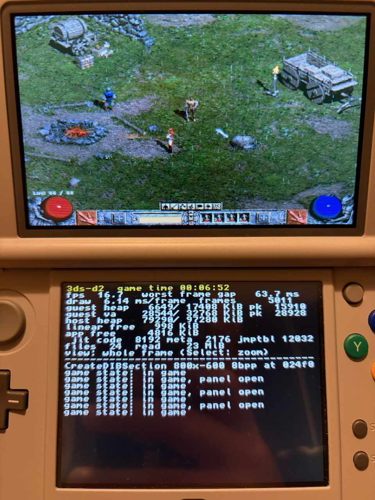

# Testing the game CIA on a New 3DS

## Build the CIA

```sh
scripts/docker.sh package-cia                                      # the hardware build, ~2 MB
scripts/docker.sh package-cia --slim ../3ds-d2-gamefiles/1.14d     # with the game files inside, ~850 MB
scripts/docker.sh package-cia --full ../3ds-d2-gamefiles/1.14d     # with every MPQ inside, ~2 GB
```

The hardware build is `dist/cia/3ds-d2-<version>-<build-id>.cia`. It holds the app only and reads the game files from `sdmc:/3ds/3ds-d2/game/`, so a new build is a 2 MB install. The two bundled variants add `-slim` or `-full` to the name. A `.txt` next to each CIA lists its version, SHA-256 and the files inside. Every run checks the CIA's content, exheader and logo hashes with `ctrtool`, the same hashes the console's AM checks at the end of an install.

The build ID is a hash of everything that goes into the CIA: `src/`, the build rules, the CPU backend's patch series and the packaging (`scripts/package-cia.sh`, `packaging/cia/`). The title version (`version=` in `scripts/package-cia.sh`, now 0.4.0) is what FBI and the HOME menu show.

The game files on the SD card, once: copy `Game.exe` and the MPQs of your 1.14d install to `sdmc:/3ds/3ds-d2/game/`. `scripts/docker.sh sdcard-folder [--full] <game-dir>` prepares that folder in `dist/sdcard/3ds/3ds-d2/game/` (hard links, nothing copied). Copy `dist/sdcard/3ds` onto the SD card root. Sound needs the real music and speech archives, so use `--full` there (or copy the install as is).

The bundled variants:
- **slim:** the CIA carries Game.exe, d2data, d2exp, d2char, d2sfx and patch_d2 from your install, and nothing else. The cinematic, music and speech archives become empty 288-byte MPQs (`packaging/cia/make_stub_mpq.py`). The game only checks that those exist and open, and asks for the Expansion disc if they are missing.
- **full:** every file.

The bundled variants contain your copy of the game: they are for your console only. `dist/` is git-ignored.

What the CIA asks the console for (`packaging/cia/3ds-d2.rsf`):
- **Memory:** the New 3DS's extended memory mode, 124 MiB instead of the ~96 MiB a `.3dsx` gets.
- **CPU:** 804 MHz and the L2 cache.
- **System calls:** `ControlProcessMemory`, which the JIT uses to make its translated code executable on real hardware.

## Install

You need a New 3DS or New 2DS XL running Luma3DS, and FBI (or Universal-Updater) to install CIAs. Allow about 0.9 GB of free SD space for the installed slim title (2.1 GB for --full).

Either way works:
- **Network install** (no copy of the CIA on the SD card): start FBI → *Remote Install* → *Receive URLs over the network*, then send the file from the Mac with FBI's `servefiles.py`.
- **From the SD card:** copy the `.cia` to the SD card, then FBI → *SD* → select it → *Install CIA*. You can delete the `.cia` afterwards.

The HOME menu shows the Lord of Destruction icon, and the top screen shows the title screen's burning logo, with the opening of the title music, when the title is selected. They are taken from your Game.exe, d2data.mpq, d2exp.mpq and d2xmusic.mpq when the CIA is packaged with a game directory (`scripts/docker.sh package-cia <game-dir>`). Without one, a drawn "3ds-d2" icon and a silent banner are used. `D2_BANNER` on `scripts/docker.sh package-cia <game-dir>` picks the banner:
- `animated` (the default): the burning logo as a 3D banner model, with "Expansion Set / Lord of Destruction" and "v1.14d" under it, without a background and always facing the viewer.
- `stack`: the same model without its animation, for diagnosis.
- `still`: a single-frame model with no animation.
- `static`: the first frame as bannertool's own still banner, with no model of ours.

Two more settings adjust the model. `D2_BANNER_FRAMES` sets how many of the 30 frames `animated` and `stack` use: 3 by default, which is also the most the HOME menu takes animated. `D2_BANNER_TURN=1` billboards only the planes' parent, the layout first tested on hardware, so the HOME menu turns the banner.

The HOME menu caches banners. Uninstall the title before installing a CIA with a different banner. A banner model the HOME menu cannot handle freezes it as soon as the title is selected, and only a forced power-off recovers. Our first animated banners did this, although an emulator showed them. The model is now built the way a banner tested on hardware is (see [architecture.md](architecture.md#9b-the-game-cia-new-3ds-extended-memory)). Title ID `000400000D2D3D00`.

**FBI error 0xD8E0806A** ("Cert signature or hash check failed", AM 106) at the end of an install means the CIA AM read does not match what was built. The chain and hashes are checked at packaging time, so the copy is the suspect. Compare `shasum -a 256` of the file on the SD card with the `.txt`, and copy it again if they differ.

## What to look at

The diagnostics are on the bottom screen's INFO tab (tap INFO in the tab bar; [controls.md](controls.md#bottom-screen) explains the other tabs). Please note:

1. **fps** on the main menu and in the Rogue Encampment while walking. For comparison, Azahar measured 25 in menus and ~9 in town.
2. **draw ms/frame**: the CPU cost of scaling the frame to the top screen.
3. **host heap** and **jit code / jmptbl** in town. Azahar measured 22 MiB used, of 34 MiB in the CIA build.
4. A red **JIT MEMORY FULL** line, if it ever appears.
5. **hitch** and **wait**: the last 10 s's frames over 100 and 250 ms and the longest, and what stops frames: the drawing thread's time blocked (`wait`, mostly on Storm's reads from the SD card), `ready` while another game thread runs, `host` work on its core (the scheduler, the heartbeat), and `hb`, the last heartbeat's length; on the `files` line, frames not drawn (`skip`) and sound starved (`fam`).

To measure more, tap **profiler run** on INFO, tick what to measure and start the run (sprite trace, guest code profile, file-read trace, SD card benchmark, frame timing). The session is then offered as a report with what the run wrote. There is no separate profiling build any more.

The checklist's last row, **log writes**, sets how all logging reaches the SD card, game.log and the traces alike, whether a profiler run is on or not, and a tap steps it on. game.log and the traces go through rings in memory, written by a thread of their own (`src/app/ctr_writer.h`):
- **batched** (the default): a file is written once 16 KiB is queued, or 5 s after its last write. The card's cost is per write, and a long session of small writes ended in stalls of 9–14 s (3DS-D2-14). A crash the app catches writes out what is queued; a freeze or a power-off loses up to 5 s of it.
- **every second**: what is queued is written once a second.
- **at once**: every log line and trace record is written as it is made, from the thread that makes it, so a freeze or a power-off loses nothing before it. This costs an SD card write per line, file read and sprite use, so use it to chase a crash or a freeze (issue #66), not to measure the frame rate.

The setting is saved (`tracewrites=` in settings.txt), logged as `profiler run: trace writes <buffered|second|now>`, and a report carries it as the `trace_writes` tag.

Logs are on the SD card in `3ds/3ds-d2/logs/`: `game.log` for the runtime, and `stderr.txt` for the CPU backend, including its arena line. Saves and settings are in `3ds/3ds-d2/save/`. `python3 -I tools/session_report.py game.log` summarises a session from its heartbeats: the frame rate by game state, the slowest windows and what they were doing (sprite re-loads, new code, SD reads), memory over time (with the sprites' frames' blocks and units, issue #44), and the hitches (`prof hitch:` lines: frames by interval, the longest, sprites taken and let go of, the frame thread's read wait, frames not drawn, starved sound grains) with the slowest windows' causes.

A profiler run with the guest code profile on is read with `python3 -I tools/profile_report.py game.log dist/game/Game.exe`: each thread's share of core 0, the shims' and natives' time, and the translated functions that took the most of a thread's time, with the sprite trace's own cost given apart. Both tools take `--windows fights|quiet|play|loads` (issue #73, `tools/profile_windows.py`). Fights are the slowest 15% of the steady in-game windows, quiet play the fastest 25%. A steady window has over 50 frames, under 10 sprites decoded, under 50 cache syncs, and the unit timers reading the clock 50 times a frame or more. Each tool prints the rule and the window count with its result. `profile_report.py --routines SpriteCacheTouch,0x470c30-0x470d80,0x534658` gives a frame's ms for each routine named, whether or not the tables' `--top` rows reach it. For example, on Sentry 3DS-D2-10, `--windows fights --routines SpriteCacheTouch,SpritePath` gives #37's 1.43 and 0.22 ms of a 59.0 ms fight frame.

## Things that differ from Azahar, and may fail first

- **Executable memory.** On hardware, translated code is made executable with `svcControlProcessMemory`, and its instruction cache is synced with Luma's `svcInvalidateInstructionCacheRange` (0x93). Azahar needs neither. If the game dies right after the title screen, `stderr.txt` should show where.
- **Arena placement.** The guest arena is mapped at 0x08000000 with `MEMOP_ALLOC`, and libctru's heap is moved above it. The arena line in `stderr.txt` should read `base=0x8000000 ... perdu-alignement=0 Ko`.
- **Speed.** Azahar's frame rate barely moved with its CPU clock setting (9.3 → 10 fps at 300%), so the console's real numbers are unknown until this test.

## If it crashes

- **Luma's crash screen.** Luma3DS shows the exception on screen and saves a dump to `luma/dumps/arm11/crash_dump_*.dmp` on the SD card. Decode it against the ELF saved next to that CIA:

  ```sh
  python3 -I tools/luma_dump.py crash_dump_00000000.dmp dist/cia/3ds-d2-<version>-<id>.elf
  ```

  It prints the registers and the source line of the PC, the LR and every stack word that points into the app.
- **The guest side of the same crash.** Before Luma3DS takes over, the app's own exception handler writes `crash:` lines to `logs/game.log`. When the fault is in translated code, these give the guest block and its x86 registers, what owns the fault address and each register's target (heap or VirtualAlloc block, module, thread stack), with the 16 bytes there, every guest thread with its stack and TEB, memory use, and return addresses on the guest stack. Attach `game.log` together with the dump. A `[sched] REFUSED thread` line in `stderr.txt` means the game asked for more threads than the worker stack or TEB regions hold. Before this check, such a thread silently overlapped the heap.

- **Startup report.** The first log lines show how the startup went, both on the bottom screen and in `3ds/3ds-d2/logs/game.log`. For example:

  ```
  heap 34816 KiB at 0d000000 (budget 120532 KiB), moved rc 00000000
  ```

  If the kernel refuses the moved heap, the line shows its result code and `-> default place`. The app then uses the 63 MiB layout instead of panicking.

## Hardware findings so far (New 3DS, Luma3DS, 2026-10-17)

| Step | What the console did | What the app does now |
| --- | --- | --- |
| Heap at a chosen address (0x0D000000) | refused | heap at 0x08000000, its normal place |
| Heap of "everything left" | refused above 95 MiB (`e0e01bfd`): the heap window ends at 0x0E000000 | steps down 4 MiB at a time; the 63 MiB layout fits |
| `MEMOP_PROT` to RWX on JIT memory | rc 0, but `svcQueryMemory` still reports RW (3) | success = rc 0, the query is only logged |
| Cache sync by address (0x54 / Luma 0x93) on those pages | kernel data abort: instruction-cache maintenance fault at the block's address | the data cache by range through the stock 0x54, the instruction cache whole (Luma 0x94); Luma's whole-cache 0x92 only if 0x54 is refused |

Translated code lives in a 16 MiB static pool in `.bss`. That keeps it out of the heap window and uses budget the heap cannot reach.

## First successful run on hardware (2026-10-17)



Build `3ds-d2-game-1d786a846d95-sdcard.cia` on a New 3DS (Luma3DS): the game runs, in the Rogue Encampment, with panels opening and closing. Bottom-screen panel after 6:52 of game time:

| Measure | Console | Azahar, same scene |
| --- | --- | --- |
| fps (town) | **16.7** | ~9 |
| worst frame gap | 63.7 ms | ~110 ms |
| draw (frame → top screen) | 6.14 ms | 9.9 ms |
| frames | 5,011 | |
| guest heap (now / limit, peak) | 6,649 / 17,408 KiB, peak 15,910 | same |
| guest VirtualAlloc (now / limit, peak) | 28,544 / 32,768 KiB, peak 28,928 | 29,824 peak |
| libctru heap used / size | 79,290 / 97,280 KiB, of which 64,512 is the arena: the host uses ~14.4 MiB | |
| JIT code / metadata / jump tables | 8,192 / 2,176 / 12,032 KiB | same |
| linear free / app free | 998 / 4,816 KiB | |

JIT code sits in the 16 MiB static pool, outside the heap, so in the heap figure the host is mostly the jump tables (12 MiB).

What this suggests:
- **Room left:** about 18 MiB of the 95 MiB heap is unused. The guest's VirtualAlloc, now at 28.5 of 32 MiB as the sprite cache fills, is the region to grow first.
- **Pacing:** the game paces itself at 25 fps. 16.7 is CPU-bound.

## Sound

The app plays sound through WinVita's DirectSound emulation (ds_emul) and the 3DS DSP (libctru's ndsp; `src/app/ctr_audio.cpp`). The mixer runs on the New 3DS's second application core.

**Before the first run:** ndsp needs the DSP firmware at `sdmc:/3ds/dspfirm.cdc`. Dump it once with the *DSP1* homebrew; many Luma3DS setups already have it. Without it the game runs silent, and `game.log` says `sound: ndspInit failed … is sdmc:/3ds/dspfirm.cdc there?`.

**What you hear:**
- **Sound effects:** `d2sfx.mpq` is real in every packaging mode, so they play.
- **Music and speech:** the slim CIA and the SD card folder replace them with empty stubs, so there is none. For both, copy the real `d2music.mpq`, `d2xmusic.mpq`, `d2speech.mpq` and `d2xtalk.mpq` over the stubs in `3ds/3ds-d2/game/`, or build `package-cia --full`.

## Frame-rate work (2026-10-17)

| Change | Measure | Result |
| --- | --- | --- |
| 640×480 in game, low lighting, no blended shadows, no perspective (registry defaults the game's Options can still change) | Linux lane made CPU-bound (`M4_QEMU_FLAGS=-one-insn-per-tb`), town | 1.8 → 2.6 fps (+44%) |
| Frame drawing on core 2 (copy ~0.5 MB, draw in parallel) | Azahar, town | ~9 → 13.9 fps together with the settings |
| Native floor, wall and sprite blitters (`src/game/d2_native.cpp`: 8 leaf routines hooked at their entries) | same lane, town, frames per 10 s | 22.8 → 32.7 (+43%); all 3,960 frames of a scripted session hash identical (`M4_NATIVE=late`) |
| Console | | to be measured |

The CPU-bound Linux lane is the way to compare the work per frame between builds without the console: qemu on a fast host otherwise always keeps the game at its 25 fps cap.

Checking a native routine: `M4_FRAMEHASH` on the virtual clock, `M4_NATIVE=0` against `M4_NATIVE=late`. The late mode installs the hooks on arrival in the game world. Routines that also run in the menus (the DC6 sprites) otherwise shift the moment the game is created: the scheduler preempts by instruction count and virtual time advances per switch, so the map seed and the whole world come out different, though correctly drawn. `D2_NATIVE_MASK` enables a subset of the hooks for bisecting, and `M4_DUMPFRAME=<n>` saves one frame's raw pixels and palette.

Two more settings matter for these checks:
- **`WX86_FAKETSC=1` once the script gives input in the game world** (walking, for example). Without it, `RDTSC` reads the host's clock. Then anything that changes the host's timing, even an extra hash, moves where the input lands, and the runs diverge for reasons unrelated to the change being checked.
- **`M4_HASHMEM=<va>:<bytes>`** hashes a guest memory range with every frame, for native code whose result the pixels may not show. The light grid is `0x7b0e68:0x4800`.
- **`D2_NATIVE_CHECK=1`** runs the original next to the sprite cache's two natives (`SpriteCacheTouch`, `SpritePath`, issue #37) and the locked lookups (`LockedLookup`, `CurrentLookup`, issue #38) on every call they take, from trampolines in `.text`'s slack at `0x6cb7e0`, and logs any difference (`native check: ... differ`). Over `fight.txt`: 65,536 hits and 32,768 paths (the counts it logs at powers of two), none differ; 4,096 and 2,048 lookups, entry and lock state alike, none differ. With and without the lookups (`D2_NATIVE_MASK=0xfffff` against the default), all 4,332 frames of `fight.txt` hash the same. Unlike frame hashes, it doesn't depend on timing: removing guest instructions changes the scheduler's slices, so scripted input in the game world can land on another frame.
- **`M4_SPRITE_FRAMES=0`** leaves the sprites' frames in the pool system, as the game does (issue #44; on the 3DS layouts they are otherwise in blocks of their own, `game::install_sprite_frames`). With `M4_NATIVE=late` the allocator is installed on arrival in the game world too. Over `fight.txt`, with and without it, all 4,705 frames hash the same. A sprite trace started before a late install says the frames are the pool system's (its header's flag is read when it starts).
- **`M4_POOL_PIECES=1`** logs the guest pool's free pieces at every heartbeat: how many, by size, and the largest few, with the blocks in its spare and the VirtualAlloc owners (`rt::log_pool_pieces`, issue #70). The console logs the same lines whenever a request is served from the spare or sprite frames fall back to the pool system. Use it to compare how fragmented the pool gets under two pool policies on the same script.
- **`M4_POOL_BALLAST_MB=<n>`** takes n MiB of the pool at the first heartbeat and keeps it, so a short script runs the sprite governor into its reserve. With 24 MiB on `fight.txt` (layout `ctr-n3`) the pool sits at ~5.5 MiB free, but still in 2–3 large pieces: the console's 64–256 KiB pieces come from half an hour of the cache churning across areas, which the fight does not do.
- **`M4_POOL_LARGE_KB=<n>`** sizes the pool's large-block zone (`rt::RunOptions::pool_large`; 0: none; the 3DS layouts otherwise have `game::kCtrPoolLarge`, 2 MiB), and **`M4_POOL_LARGE_MIN_KB=<n>`** sets what goes there (blocks over 256 KiB by default). The fight has no sprite frames over 256 KiB, so `M4_POOL_LARGE_MIN_KB=64` sends the frames' 128–256 KiB blocks there instead, to run the zone at all: with it, all 3,960 frames of `fight.txt` hash the same as with no zone.

Scripts for these runs are in `tests/m4/scripts/` (`M4_SCRIPT="$(cat tests/m4/scripts/fight.txt)"`): `town-walk.txt` walks around the Rogue Encampment, `fight.txt` crosses the bridge into Blood Moor and fights the quill rats there, and `act2-east.txt` takes a character that has finished Act I (`dist/save/BeforeCh1End`) to Warriv and East to Lut Gholein (issue #66). It finds Warriv in the game's units (`tapunit`, `src/game/d2_units.h`), so it does not depend on the frame rate. The fight's route is the map the virtual clock gives. The same file works on the console as `sdmc:/3ds/3ds-d2/autoplay.txt`.

Example: the native light grid (`LightGrid`, mask bit 8), with the town walk script, `WX86_FAKETSC=1` and `M4_HASHMEM=0x7b0e68:0x4800`. Masks `0xff` and `0x1ff` give the same 2,372 frames, pixels and grid alike, over 185 distinct grid states.

## Frame pacing (issue #76)

Walking around a town felt jumpy, and the 10 s frame rate did not show it: most frames took 40 ms, then one took 70–150 ms. This is measured off the console, in Azahar, and only the result is checked on the console. The jumpiness Azahar showed in town matched the console's.

**The frame trace.** The profiler's **frame timing** option writes `logs/frames.trc`, a line per frame presented (`src/game/frame_trace.h` has the format), and a report attaches it. Each line gives:
- the gap since the last frame, and how far the game's clock moved;
- the frame thread's time running, ready while another guest thread ran (and which one), in host work, sleeping, waiting on a lock, an event or a file read;
- its sprite decodes;
- for its longest wait: the game code it waited from, the thread that held the lock, and the return addresses on its EBP chain;
- the frame thread's scheduler slices: a slice is a few ms of guest code, so a long frame with many slices ran the game's own code long, and one with few was held in a host call;
- a stall: in a frame that has gone 150 ms without a present (`stallms=` in settings.txt), a watcher thread on the second core samples the frame thread every 20 ms, up to 8 times. It tells the thread to stop at its next block (the dynarec writes EIP back only at exits and traps) and keeps where it stopped: its EIP and the dword on top of its stack, the call's return after a host call. It costs the game's core nothing in a normal frame.

The trace is buffered and written by the log writer thread, so it does not make frames uneven itself. `python3 tools/frame_report.py frames.trc` counts the frames in game with no panel open and gives:
- the gap percentiles and the share past 50, 60 and 100 ms;
- the jitter (the mean change from one gap to the next);
- the share of frame pairs near 40 ms;
- what the slow frames did instead, with the threads and wait sites behind them.

**An unattended walk in Azahar.** This runs a CIA and writes `frames.trc`, `game.log` and `report.txt` to `build/smooth/<time>/`:

    scripts/measure-smoothness.sh --save DuringCh2Mid [--setting stormdirect=0] [--cia <file>]

It plays `tests/m4/scripts/smooth-walk.txt`:
1. the first character into the game;
2. a profiler run with the frame trace only;
3. 90 s of circle-pad loops around the town. A panel the walk clicks open (an NPC's menu) is closed with START (`closepanels`).

`--save` picks the starting point: `BeforeCh1End` (the Rogue Encampment) or `DuringCh2Mid` (Lut Gholein, the busier one). The zips beside the saves in `dist/save/` restore them.

Two runs of the same build differ by a few points, so compare settings over alternating runs, two or more each. Azahar is slower than the console per guest instruction, so its figures compare builds with each other; they are not the console's.

**What made the frames uneven, and the changes.** All guest threads take turns on one core.
1. Storm's read thread (thread 4, entry `0x41a550`) decompresses what it reads with the Huffman, ADPCM and PKWARE natives. A turn was 300,000 guest instructions, and time in natives did not count toward it, so one long decode kept the core for 10–16 ms.
   - Turns of other threads are now 40,000 instructions (backend patch 0059; `bgquantum=` in settings.txt, `M4_BG_QUANTUM` on the lane).
   - A background thread past 2 ms yields once a native returns, when the frame thread is waiting to run (`bgslice=`).
   - The read thread's decoders run on the I/O worker's core while it waits (`rt::offload_job`). Each job takes under 1 ms there.
2. The frame thread's own small reads (a sprite file's header at `0x5fdf2c`, sounds) waited about 35 ms at `0x41af0d`, Storm's wait for its read thread. The read thread serves them next (`install_storm_read_priority`), but first finishes what it is doing: after reading a load, its completion callback decodes the whole sprite group in guest code (`0x5ff6e0` → `0x60bff0`), 30–60 ms in Azahar. Storm's request size made no difference (16 against 4 KiB).
   - A caller with no OVERLAPPED now reads on its own thread under Storm's lock whenever the read thread is not inside its own read (`install_storm_direct_reads`, `src/game/storm_reads.cpp`), as Storm does for an archive opened for synchronous reads. The read thread marks its read with a flag. It cannot start another without the lock, so the archive's handle is never used by both at once.
   - `stormdirect=0` in settings.txt (`M4_STORM_DIRECT=0` on the lane) leaves those reads queued. The heartbeat logs `storm reads: <n> read by their caller, <n> queued`.

Lut Gholein, 90 s walks in Azahar:

| Build | Past 50 ms | Past 60 ms | Jitter | Pairs near 40 ms |
| --- | --- | --- | --- | --- |
| Before (two runs) | 21.2%, 18.8% | 9.3%, 7.6% | 10.0, 9.3 ms | 61%, 65% |
| Shorter turns and the time limit | 18.5%, 14.9% | | 7.4, 6.8 ms | |
| ...and the decoders on the I/O core (five runs) | 6.6%, 9.5%, 5.8%, 6.6%, 9.6% | 3.3–5.3% | 4.7–5.8 ms | 83–88% |
| ...and direct reads (two runs, against four without them on the same build) | 9.6%, 6.5% (without: 10.6%, 9.1%, 8.3%, 11.3%) | 4.7%, 3.2% (without: 3.9–6.2%) | 6.0, 4.8 ms (without: 5.0–7.3) | 82%, 87% (without: 78–85%) |

Direct reads are a small gain in Azahar, where a read from the emulated SD card costs about 5.6 ms; the waits they remove are the 35 ms ones at `0x41af0d`. Reads that find the read thread mid-read are still queued: having the caller wait for that read instead, the lock held, made the frames much worse (15.6% and 22.3% past 50 ms).

What the slow frames left in Azahar did instead, roughly a third each:
- **run**: the frame thread's own work running long (new sprites' decodes on its own thread, the game's logic);
- **ready**: the read thread running, mostly its callbacks' sprite decodes in guest code;
- **wait**: reads queued behind the read thread, and the frame thread's own reads from the card.

**The console (3DS-D2-17, New 3DS XL, build `b6a947728230`, 251 s in Lut Gholein):**

| | Past 50 ms | Past 100 ms | Median frame | Jitter |
| --- | --- | --- | --- | --- |
| Whole run | 6.0% | 0.49% | 39.8 ms | 7.3 ms |
| First 70 s in town (loading) | 10–20% a window | up to 8 a window | | |
| From 110 s on | 2.4% | almost none | | |

- **Slow frames.** The read thread's turns barely matter on the console (16 of 356 slow frames, against a third in Azahar). The rest:
  - the frame thread's own work (217);
  - its own SD reads (85), 20–27 ms each: a disk read costs 6–9 ms there, about as in Azahar.
- **Stalls of a fixed ~640 ms** (one of 1.3 s): pure run, with no read, wait or new sprite, and the JIT translated nothing new meanwhile. Eight in the 40 s after arriving in town, then one every 40–90 s. Azahar never shows them.
  - They often fall in the same window as a slow SD write by the log writer: 600–1,400 ms writes of `frames.trc` and `game.log`, about every other heartbeat, likely as the files grow by a cluster.
  - But they last 640 ms whatever the write's length, and some come with no slow write.
  - The stall column above was added to name them on the next console run.

**Loading: the game's file calls (Azahar, `tests/m4/scripts/act-load.txt`).** The Act I save goes to Warriv and on to Lut Gholein with the frame trace on (`--save BeforeCh1End --script tests/m4/scripts/act-load.txt --seconds 300`, then `tools/frame_report.py --all --timeline`). The act change's longest frame was 4.3 s. The stall samples put it after `GetFileAttributesA`, `CreateDirectoryA`, `CreateFileA` and `ReadFile`: the game's save at the act change.
- Every lookup is a stat on the card, 30–90 ms each in Azahar. The game repeats the same ones: its save folder's three levels at each save (9 times in this run), a file in the write root and then the data root before each open, the MPQs' names. It also reads its settings one key a call (`GetPrivateProfileIntA`), each a read of the whole INI file.
- File calls past 2 ms took **13.4 s** of the run: `GetFileAttributesA` 4.3 s, `CreateFileA` 3.8 s, `GetPrivateProfileIntA` 1.7 s, `CreateDirectoryA` 1.2 s.
- The file shims now keep:
  - each host path's stat ("absent" included);
  - each directory's listing (`FindFirstFileA`);
  - each INI file parsed.

  The game's files change only through these shims, and each change forgets the path, its directory's listing and the INI files (`touched`). A rename forgets everything.
- After: file calls past 2 ms took **2.9 s** (`GetFileAttributesA` 0.57 s, `CreateFileA` 1.07 s, `GetPrivateProfileIntA` 0.03 s). The act change's longest frame is **2.4 s**, and the arrival's worst 10 s window went from 1,018 ms to about 200 ms at its longest. What is left is mostly each path's first lookup and the save's own writes and reads.
- A file call of 20 ms or more is logged (`slow file call: CreateFileA("...") 48 ms`).

**The console with the file caches (3DS-D2-17, build `e7386f3e01c1`):** Lut Gholein, Rocky Waste and back, 253 s. The player felt the area change and the small mobs much smoother, and the return to town held 25 fps.

| Part | Frames past 50 ms per 10 s window |
| --- | --- |
| Arriving in Lut Gholein (0–40 s) | 10–25% |
| Rocky Waste (90–125 s) | up to 46%, one frame of 515 ms |
| Back in town (130–240 s) | 1–6%, nothing past 100 ms |

On the whole run, 7.7% of frames went past 50 ms.
- The median frame is 38.9 ms of the frame thread's own work: there is no slack in a 40 ms frame, so any read or load in one makes it late.
- In the #70 session's guest profile (an older build, same town), the frame thread ran 9.3 s of 10, of which 2.5 s in shims and natives; the other ~6.8 s is translated game code. A stable 25 fps needs that time down.

**Tried and dropped on the way (each measured, none a gain):**
- **The I/O worker serving the frame thread's reads first** (a second ring). The console's next run (build `339e8dcc60c0`) had the frame thread's own reads wait as long as before (23.7 ms over 141 frames, 76.9 ms over 58). The cost is each read's chain of small Storm reads, not the queue. Reverted.
- **The dynarec's translation knobs** (`callret=`, `nopend=`, `budgettail=`, `forward=` in settings.txt; `M4_CALLRET`, `M4_NOPEND`, `M4_BUDGETTAIL`, `M4_FORWARD` on the lane). On the CPU-bound lane (town walk, `-one-insn-per-tb`), none changed the frames per 10 s (32–34 either way). `nopend` and `budgettail` keep `fight.txt`'s 3,215 frames byte for byte; `callret` moves the scheduling from the menus on. Kept as settings, off.
- **Storm's read thread's rate limit** (`stormrate=`, the game's 256 KiB/s): the act load in Azahar took as long with 4 MiB/s. Kept as a setting.
- **Storm's request size** (16 against 4 KiB), **shorter background turns** (10,000 instructions, 1 ms), **a caller waiting for the read thread's read under Storm's lock** (much worse), **a word-wide shade remap and an identity-table copy for the floor** (5.9 against 6.0 µs a tile): no gain, not kept.
- **Per-call shim timing for the stall column**: Azahar lost 2 fps to it; replaced by the sampling watcher.

## Floor tiles on the second core (issue #80)

The frame thread had no slack in a 40 ms frame. Drawing is most of its work, and the draw natives write only the frame buffer. So some of that work can move to core 2, as long as the game's own drawing never sees the buffer half done.

**Where a frame's drawing can move: the draw census (lane).** `D2_DRAW_CENSUS=<n>` takes every n-th frame. At each draw native, it compares the frame buffer with a copy taken after the last one. A difference means the game's own code drew in between. `python3 -I tools/draw_census.py build/m4/err.txt` groups each frame's natives into runs with no game drawing among them, with each run's callers.
- After the screen is cleared, the floor is one run: about 96 `FloorTile` calls with nothing else drawn among them. They come from the world's draw (`0x476bc0`) through its call to `0x4ded10` at `0x476cdc`.
- The very next call (`0x476ce1`, to `0x473c00`) draws over the floor.
- After that, the game's own drawing (the walls' smaller blitters, the UI) comes in between the wall and sprite natives every 1–20 calls. A queue there would wait at each one.

**What a frame spends: the draw phases.** `drawphases=1` in settings.txt (`D2_DRAW_PHASES` on the lane) times each draw native and the frame's parts with the host clock. It logs `draw phases:` every 250 frames. A 41 ms town frame in Azahar (Lut Gholein):

| Part of the frame | ms |
| --- | --- |
| From the last blit to the floor | 12.3 |
| The floor run | 10.2 (`FloorTile` 8.1, the frame thread's own work between tiles 2.1) |
| From the floor to the blit (walls, units, UI) | 18.7 |
| Present (copying the frame for the render thread) | 1.1 |

**The floor queue** (`floorqueue=1`, the default on a New 3DS; `0` turns it off; `D2_FLOOR_QUEUE` on the lane), in `src/game/d2_native.cpp`:
- The call at `0x476cdc` arms it, and the call at `0x476ce1` empties it. Both are redirected to natives that then go on to the call's own target.
- While it is armed, `FloorTile` queues a tile whose blocks all have flat light. Each tile is queued with a copy of the light cells it reads and of the renderer's globals it was called with: the frame buffer, its pitch, the clip window and the light flags.
- A worker thread on core 2 draws each tile as soon as it is queued. When the queue is emptied, the frame thread draws whatever is left beside the worker, then waits for the worker's last tile.
- Floor tiles do not overlap, so the order they are drawn in does not matter.
- Any other draw native empties the queue first. In the measured runs none had to.
- A tile with interpolated light needs the game's own blitters, so it is drawn at once, after the queue is emptied. The console sets "Light Quality" to 0, so it has none.

**Checks on the lane** (virtual clock, `M4_NATIVE=late`, `M4_FRAMEHASH`):
- `D2_FLOOR_QUEUE=2` draws the queue in reverse order at the end of the run. `town-walk.txt` (1,726 frames) and `fight.txt` (2,843 frames) hash the same as with the queue off.
- With the worker, one early run of `fight.txt` differed in one frame. That was before each tile kept its own copy of the globals; the worker then read them while it drew. After that change, three more runs matched.
- `D2_FLOOR_QUEUE=3` uses the worker, then draws every tile again in order and counts any pixel change. 26,276 flushes changed nothing, and every frame hashed the same.

**Azahar** (Lut Gholein and the Rogue Encampment walks, the queue off and on, alternating):

| | fps | Median gap | Past 50 ms | Floor run on the frame thread |
| --- | --- | --- | --- | --- |
| Lut Gholein, off (2 runs) | 21.3, 21.4 | 43.8, 43.4 ms | 13.1%, 13.5% | 9.7, 10.2 ms |
| Lut Gholein, on (2 runs) | 23.1, 23.3 | 39.9, 40.8 ms | 8.3%, 6.1% | 2.95, 2.78 ms |
| Rogue Encampment, off | 22.8 | 41.9 ms | 7.5% | 8.0 ms |
| Rogue Encampment, on | 23.7 | 40.2 ms | 4.4% | 2.4 ms |

- The worker draws about 65% of the tiles. The frame thread waits 0.4 ms a frame for its last one.
- The act-load script was unchanged: 25.0 fps and 0.2% past 50 ms either way. Its longest frame went from 323 to 225 ms.

**Not kept:** native versions of the four interpolated-light blitters (`0x4f6bb0`, `0x4f71a0`, `0x4f7850`, and `0x4f89f0`'s iso branch), so that those tiles could be queued too.
- Checked block by block on the lane against the game's own blitters, they drew the same pixels.
- A few frames still differed, because the lane's virtual clock counts the guest instructions they no longer run.
- The console never draws interpolated light, so they would only help a player who raises Light Quality.
- Parked as [parked/gouraud-natives.patch](parked/gouraud-natives.patch), against commit `d9c08c1`. Take it up if a player raising Light Quality is reported, or asked for. With Light Quality up, interpolated tiles are drawn at once on the game's thread, as before issue #80.

## Blood Moor: VirtualAlloc ran out (2026-10-18)

After about four and a half minutes, three of them in Blood Moor, the console logged `va full: want 512 KiB, live 44416 KiB, largest free 384 KiB`. The 44 MiB VirtualAlloc range was full, while the heap range held 8.2 MiB of its 17 (peak 9.7). The game kept going after the failed allocation, the sound looped, and translated code then faulted on a wild guest pointer (data abort, far = membase + 0x357db9e8, outside the 75 MiB arena).

Fix: the heap and VirtualAlloc ranges are now one 61 MiB pool (`GuestRegion::share`): the heap grows up from its base and VirtualAlloc down from the top. The heap peaks while loading (15.9 MiB at hero selection on the Linux lane) and then drops to ~7–8 MiB in play, which is when VirtualAlloc grows, so the same arena now leaves VirtualAlloc ~53 MiB in play instead of 44. The panel shows what is left of the pool (`free`) and its largest block (`big`).

If long sessions fill the pool too, the next lever is D2's sprite cache: `0x457300` clamps it to at least 24 MiB (`mov edx, 0x1800000` at `0x4573e7`). Its own formula gives 13–15 MiB for the 64 MiB we report.
